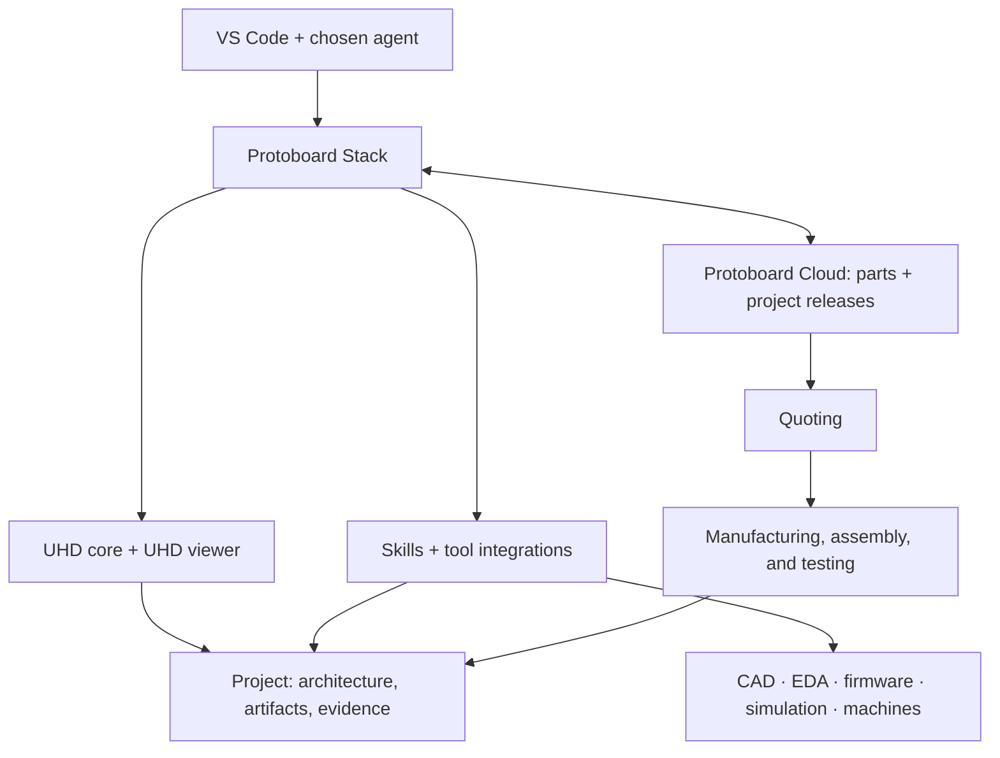

# Protoboard Stack architecture

Status: agreed product direction; technical contracts proposed for implementation.
Updated: 2026-09-21.

## Identity

Protoboard Stack is a reusable hardware development framework and the tools-and-
skills harness through which agents and humans use it. UHD connects modules,
interfaces, harnesses, specifications, and engineering artifacts. Protoboard
makes that context actionable across design, sourcing, fabrication, assembly,
firmware, and testing.

The viewer is one framework capability. The product is the complete hardware
project experience, including the engineering workflows and supporting tools.
The initial working environment is VS Code with a user-selected agent. The same
project must be usable through a headless CLI in an agent sandbox or CI.

Protoboard does not own a persistent agent runtime: model selection, conversation
state, planning loops, session scheduling, and agent hosting belong to the
selected agent environment. ProtoBot is a separate product and a possible client.
Project decisions, engineering evidence, and work records persist as project
files independently of any agent session.

## Ownership and dependencies

| Component | Owns |
| --- | --- |
| UHD core | Canonical hardware data, composition semantics, interfaces, harnesses, artifacts, and model-level validation. |
| UHD viewer | Independent rendering and inspection of UHD, artifact navigation, layout, embeddable UI, and a local serving entrypoint. |
| Protoboard framework | Project loading, dependency resolution, artifact provenance, diagnostic aggregation, extension discovery, development sessions, operation records, and release packaging. |
| CLI and editor integration | Human and machine access to framework capabilities; VS Code is the first editor target. |
| Extensions | Skills, templates, engineering conventions, tool adapters, artifact handlers, and optional checks or operations. |
| External agent / ProtoBot | Reasoning, planning, skill selection, tool invocation, and agent session lifecycle. |

UHD core imports no Protoboard code. The UHD viewer depends on UHD and a neutral
view contract, not on a Protoboard compiled-project type. Protoboard projects
are adapted into that contract. Its dev command integrates the viewer's serving
capability with project watching, diagnostics, and artifact resolution.

Native CAD, EDA, firmware, and simulation tools remain authoritative for their
own detailed formats. UHD describes system relationships and the interfaces
between modules; it does not absorb native geometry, PCB layouts, or source code.

## Project and artifact model

A project combines UHD source, native artifacts or references, requirements,
parts selections, engineering decisions, tool configuration, and evidence.
Purchased and custom modules use the same UHD composition model. A custom module
can exist with requirements before its detailed design artifacts are complete.

An artifact reference establishes an association. It does not prove that a
file agrees with the model. Extensions may extract properties and compare them
with UHD; diagnostics must state which checks ran, failed, or remain unknown.
Model validation alone does not establish physical performance or readiness.

Keep design intent, operation requests, and observed results distinct. For
example, a frame module, a print job for its released CAD revision, and a
measurement of one printed frame are related records, not the same object.

## CAD and spatial UHD visualization

Tight CAD integration is a central capability: extensions should inject and
show UHD modules and interfaces in the CAD experience, associating them with
actual geometry. Parent interfaces without geometry display the mapped geometry
of their children (for example, an I2C group highlights its individual pins).
The future spatial view also displays module instances and harness geometry,
including wires and a bolt connecting two plates.

Prototype the mapping and interaction before committing to a full integrated
CAD viewer. Zoo.dev is a candidate for investigation; Onshape or a STEP viewer
may also support a prototype path. Provider capabilities and selection remain
open. See [CAD/UHD integration](cad-uhd-integration.md) for semantics and scope.

Before UHD viewer implementation, draw the proposed interactions and settle
the design decisions. Headless framework and catalog work can proceed
independently.

## Extension model

Distribute extensions as ordinary npm packages. Use npm dependency resolution
and its lockfile; do not build a package manager. The framework discovers
explicitly configured installed extensions and connects their declared skills
and capabilities to the project.

An extension may contain skills and references, templates, tool requirements,
CLI/SDK/MCP adapters, artifact handlers, validation hooks, and named operations.
Skills provide engineering guidance; executable adapters produce structured
results. An extension can be skills-only. External desktop tools, Python
runtimes, credentials, and physical devices remain external requirements;
installing an npm package does not mean those requirements are available.

Agent-environment adapters expose skills using the host's supported discovery
mechanism. This is compatibility plumbing, not an agent runtime. Headless
operations must return structured output and useful errors without a TUI.
A sandbox can perform the operations supported by its installed tools and
network/device access; unavailable capabilities are reported explicitly.

Prefer composable domain packages to forks. Robotics, IoT, drones, gaming PCs,
and FRC can combine and specialize shared packages. An organisation's own
projects workspace can add company conventions, shared memory, and
cross-project context. Reusable workflows taken from such a workspace should
be extracted without making one company's suppliers, credentials, or policies
framework defaults.

## Parts and cloud boundary

The first cloud service is a small UHD-native parts catalog with search and
versioned downloads. A downloaded definition has an immutable revision, a
source service and part identity, a retrieval record, and a content digest.
Dependencies and required local artifacts are materialized for repeatable use.
Ordinary local loading and validation do not query the catalog or change pins.

Support local authoring, npm-provided definitions, and catalog downloads.
Catalog download is data retrieval, not a replacement package manager. Locally
modified catalog parts retain their origin and an explicit derivation record.
Datasheet links and cached files are supporting evidence. Structured library
facts should carry their source and unresolved assumptions so agents can avoid
repeated extraction without treating missing information as verified.

The earlier Protoboard web app's service uses ProtoPart. It is not the UHD catalog. Reuse
infrastructure where useful, but conversion must be explicit and validated.
Until catalog coverage grows, sourcing skills support external discovery,
datasheet extraction, and local UHD definitions.

## Ecosystem

| Product or operation | Responsibility |
| --- | --- |
| Protoboard Stack | Local hardware development and release preparation. |
| Protoboard Cloud | UHD catalog, hosted project releases, accounts, and future collaboration and fulfillment coordination. |
| Quoting engine | Evaluate a fixed release plus quantities, sourcing, fabrication, assembly, and test requirements. |
| Prototype contracts | Human execution of engineering and manufacturing workflows today; a source of tested reusable procedures. |
| Future factory runtime | Coordinate manufacturing, assembly, and testing through machines and robots, consuming project releases and recording results. |
| ProtoBot | Separately developed agent runtime that may use the stack and cloud services. |

A deployment publishes a particular project release. Quoting, ordering, and
physical execution are separate operations against identified inputs. Execution
integrations keep target/environment configuration outside portable design
intent and record input revisions, tool versions, outcomes, and evidence.
Machine controllers remain responsible for device-level control and interlocks.

The long-term ambition is an agentic harness for hardware factories. Preserve
traceability from design to physical units and tests now; defer factory scheduling,
robot coordination, and autonomous execution infrastructure until actual
workflows require them.

## First reference project

Build a quadcopter using a custom frame, purchased propulsion/control/power
modules, locally authored UHD definitions, and downloaded UHD library parts.
Link frame CAD, controller firmware/configuration, datasheets, assembly
instructions, and test evidence to the relevant modules.

This exercises the whole framework without requiring a new flight controller
PCB or a new flight-control implementation. Exact components, frame process,
and performance targets are engineering decisions for the reference project's
brief, not architectural prerequisites.
