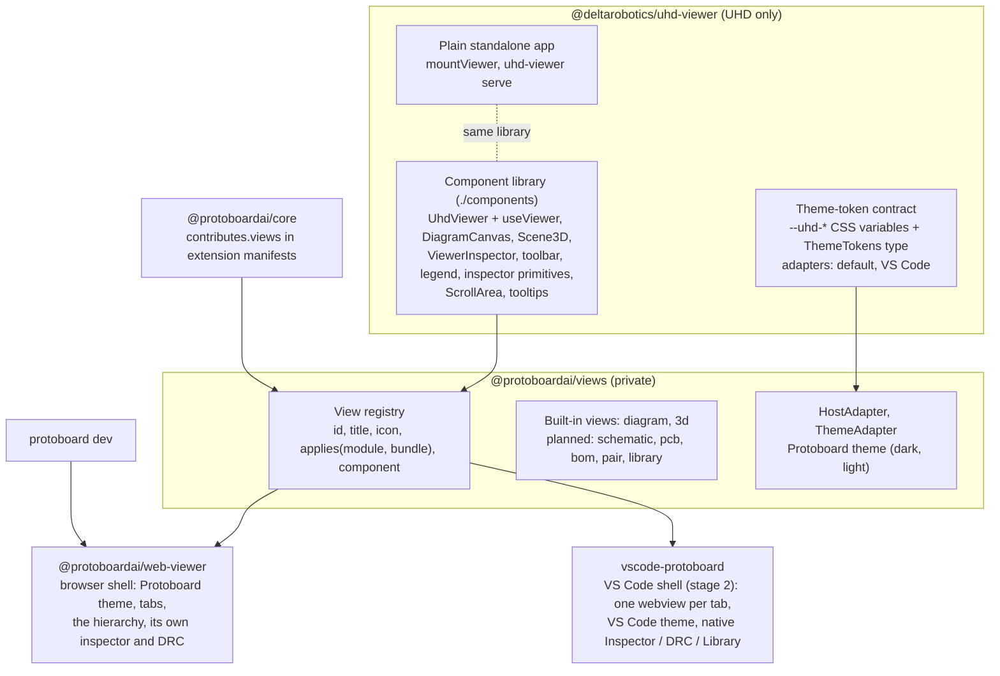

# The viewer stack

Status: stage 1 built in Stack 0.1.3, under the VS Code extension's v3
layout (vscode-extension.md). Stage 2 builds the domain views and the VS Code shell
on top of it.

Protoboard shows a project in several hosts: a browser (`protoboard dev`, later
the hosted site), VS Code, and later a desktop app. They share one set of
views and differ only in their shell: where tabs, inspectors and DRC live, and
which theme applies. The stack is three layers and a shell per host.



## Layers

### uhd-viewer: UHD only

`@deltarobotics/uhd-viewer` knows UHD and nothing about Protoboard: no brand
colour, no product name, no Protoboard type. It may be published as open
source with UHD. It ships three entries:

| Entry | What | For |
| --- | --- | --- |
| `.` (`mountViewer`) | The plain standalone app, React and Three bundled in | Hosts that want a viewer in an element; `uhd-viewer serve` |
| `./components` (+ `./components.css`) | The component library; React, React DOM, Three, React Flow, Radix and Lucide are imports | Shells that compose their own UI |
| `./tailwind-theme.css` | Tailwind 4 theme mapping utilities onto the tokens | Shells with their own Tailwind build |

The component library holds no app chrome. Its parts:

- **State.** `UhdViewer` loads a bundle (`bundle` or `bundleUrl`) and
  provides the viewer's state; `useViewer()` reads it: the drawn level, the
  selection, drill path, classification, layout edits, scenario, findings,
  and the actions that change them. Every view below reads this one state, so
  selection and drill level carry from the diagram to the 3D view and to the
  inspector.
- **Views.** `DiagramCanvas` (with `DiagramToolbar`, `DiagramLegend`,
  `ScenarioBanner`), `Scene3D` (with its own toolbar and, when asked, its
  inspector), `ViewerInspector` (selection, the level's list and system checks),
  `ViewerHierarchy` (the whole module tree, docked at the left),
  `ViewerNodeMenu`.
- **Details on their own.** `SelectionDetails` is what `ViewerInspector`
  shows for a module, a link, a net or a definition, without a viewer: for a
  host with an inspector of its own. `ArtifactCard`, `ArtifactGrid`,
  `ArtifactCards` and `artifactCards()` show every artifact as a card;
  `EvidenceSection` a part's evidence.
- **Primitives.** `Toolbar`, `IconButton`, `ToggleGroup`, `ToolbarSeparator`,
  `Legend`, `LegendItem`, `InspectorPanel`, `Section`, `PropertyRow`,
  `Badge`, `StatusDot`, `EmptyState`, `ScrollArea`, `Icon`.
- **Theming.** The token contract, `ThemeProvider`, the adapters.
- **Host contract.** `renderViewer(element, options, Shell)` mounts any shell
  with the viewer's host channel (below); `parseHostMessage`,
  `isViewerEvent`, `originAllowed`.

The standalone app (`src/app`) is the library's views in a small chrome:
breadcrumb, the view and scenario controls, the activity rail. `uhd-viewer
serve` and `mountViewer` work as before.

### @protoboardai/views: Protoboard's views and the registry

`packages/views` holds what every Protoboard shell shares:

- **The view registry** (`ViewRegistry`). A view is
  `{ id, title, icon, applies(module, bundle, at?), component?, order?, description?, source?, uhd? }`.
  `register` refuses a second view with an id unless it replaces it (a
  stage 2 track's working schematic taking over the planned one).
  `forModule(module, bundle, path)` gives the tabs for the focused module, in
  order. A view without a component is *planned*: its tab exists and shows a
  placeholder.
- **Built-in views.** `diagram` (always) and `3d` (the module or one below it
  has a `.glb`) wrap the uhd-viewer's canvases (`uhd: true`: they share the
  shell's one viewer state). Planned: `schematic` (`schematic.svg`), `pcb`
  (`pcb-top.svg` or `pcb-bottom.svg`), `bom` (the root, or a module with
  `bom.csv`), `pair` (a module with links), `library` (the root). Predicates
  test standard-output file names (docs/specs/tool-integrations.md §8), never
  the tool that wrote them.
- **Contributed views.** `registerContributedViews(registry, views, components)`
  registers what extensions declare (next section).
- **Host adapter** (`HostAdapter`): what a view may ask of its shell, every
  method optional: `openSource`, `openArtifact`, `openView(viewId, path)`,
  `selectionChanged`, `notify`. The web shell opens a view as a tab of its
  page; the VS Code shell will open an editor tab.
- **Theme adapters.** Protoboard's own theme (`protoboardDark`,
  `protoboardLight`, `protoboardThemeAdapter`) lives here, not in the
  viewer; `themeAdapterFor(choice)` maps a shell's theme choice
  (`protoboard-dark`, `protoboard-light`, `protoboard-system`, `vscode`,
  `default-dark`, `default-light`) to an adapter.

- **The Inspector's selection and the DRC panel**:
  `@protoboardai/views/inspector`. `SelectionInspector` takes a card (the
  header, chips, findings and sections a shell computes) and draws
  uhd-viewer's `SelectionDetails` inside it, so a host's native inspector
  shows a module the way the viewer's does: the facts, every artifact as a
  card (`ArtifactCards`), the evidence, the interfaces and pins. `DrcPanel`
  is the findings in severity lanes. Both draw on `PartsSurface`, so they
  have the parts views' card surfaces and, on a light theme, the deeper
  shades of the severity colours; the Inspector gives the viewer's
  link-state colours (an audit, assumptions, a link's diagnostics) the same
  deeper shades there. In a native view faint text is the foreground
  stepped towards the background (`vscodeViewThemeAdapter`), the foreground
  itself in high contrast: VS Code's disabled colour is too pale for the
  keys of the facts. Models are in `inspector/model.ts`
  (`@protoboardai/views/inspector-model`, types only, for a shell's Node
  side).

- **Part status**. The viewer knows nothing of parts: a host marks
  modules through `nodeMarks` (a definition id to `{ tone, label }`; the
  corner dot of the module's card takes the tone and says the label). The
  shells get every definition's status from `protoboard dev` (`partStatus` in
  its state and in each rebuild's event; `definitionTrust` in core), turn it
  into marks with `nodeMarks()` from `@protoboardai/views`, and render
  `PartStatusStyles` once, which sets the status colours per colour scheme
  and points the viewer's `--uhd-mark-<tone>` at them.

### The parts views (`@protoboardai/views/parts`)

The library, a part's detail, the project's parts, the libraries manager,
the bill of materials and the Cloud panel are components of the views
package, drawn the same in every shell. They take plain data
(`parts/model.ts`) and call back with actions; a shell computes the data.

- **Data.** `@protoboardai/views/parts-data` (`library-data.ts`, no React, no
  host API) turns the library client's answers into the models: the
  category drill-down, the result cards, a part's detail, the project's part
  groups, the BOM as CSV. The VS Code extension and `protoboard dev` both
  use it. `@protoboardai/views/parts-model` is the models' types alone.
- **Registry views.** The built-in `library` and `bom` views are now these
  components. A shell gives them data with `PartsDataProvider` (a
  `PartsData`: search, part, vendor, project parts, BOM); without one they
  say so. The web shell's comes from `protoboard dev`
  (`createDevPartsData`, the `/__protoboard/parts/` routes: library search
  and part details with the core library client, files through a verified
  cache, `parts list`, `bom`, and `parts add|update` with the session token).
- **VS Code** draws them in native slots and editor tabs instead
  (vscode-extension.md § 2.5).
- **Card carousels.** Every list draws the one `PartCard`: the
  Library side bar (rows), the full-page library and the Project Parts page
  (tiles or rows). A card has two carousels and one size:
  - *Pictures*, on top (at the left of a row): the catalog picture, then any
    other picture the revision carries. Dots always; arrows and the "2 / 4"
    index on hover or focus (always where there is no hover). One picture:
    no dots, no arrows.
  - *Text*, under the title, which never changes: Overview, Specs,
    Dimensions, Interfaces, CAD, Artifacts, with a "‹ n/N ›" pager and page
    segments, in a box of fixed height (68 px on a tile, 46 px on a row).
    A tile is 300 px high on every page. A page the part has no data for is
    left out (`availablePages`), never drawn empty.
  - *Data* (`parts/part-pages.ts`, no React): specs from the definition's
    electrical, thermal and other domains (power domains, operating range,
    then each `metadata` figure, its unit read from the key: `max_power_W`),
    dimensions from the mechanical domain (an outline drawn to scale, size,
    mass, the rest), interfaces as chips (buses first, the same chip
    counted), CAD as a summary (STEP size, vendor or generated and its
    licence or tool, mate features) with a still picture, artifacts by kind
    with counts. A list never loads a model.
  - *Lazily.* A card asks for its pages when the reader first rests on it or
    turns it (`PagesSource`: once per part and revision, four at a time,
    kept; a skeleton while loading; a failure with "Try again" in the card).
    The shell answers: `actions.pages(ref)`, which is `GET parts/pages` on
    `protoboard dev` and a `pages` message to the extension. A library part
    of the project shows its pinned revision's pages; a part of the
    project's own has only its overview.
  - *Place.* A list keeps where each card is (`PagerStore`), so a card that
    scrolls away and back, and a part opened and closed, come back where
    they were. The list's link switch turns every card together (one pager
    moves them all, to compare one page across the parts); a part without
    that page keeps to its overview.
  - *Keys and gestures.* A focused card: ← and → turn the pages, Shift with
    them the pictures, Enter opens the part; the arrows are out of the tab
    order (one stop per card, then its actions). A touch or pen swipe and a
    trackpad's sideways scroll turn too. The one motion is a 140 ms fade,
    off with `prefers-reduced-motion`.
  - *Window.* `Windowed` keeps a card far from the visible part of the list
    as an empty box of its size (one IntersectionObserver per list, 700 px
    of margin), so a list of several hundred parts scrolls like a short one
    and its scroll position never moves.
- **Part detail.** The back control and the
  category trail at the top left; the pictures as a larger carousel with a
  thumbnail strip and a larger view; then the same pages as tabs, larger,
  followed by **Prices** and **Revisions**. The body model is fetched when
  the CAD section opens (a mesh over 25 MB when the reader asks for it).
- **Prices by source.** The detail's Prices section shows the offers the
  part's library serves (`partPrices` of the core library client; `GET
  parts/prices` on `protoboard dev`, a `prices` message in VS Code): per
  supplier the price breaks, currency, pack, minimum order, stock, the day
  observed and the link; US dollars first, never converted. Asked for when
  the section first opens. A refusal (not signed in, account not invited, a
  library without prices) is said with what to do. Only the members the
  service serves users are shown (its public offer fields);
  nothing about how a price was read exists in the views' model.
- **Look.** Tokens only: cards are a wash of the text over the background
  (the earlier Protoboard web app's card in the Protoboard themes, the page with an outline in high
  contrast); the body face is VS Code's in a webview, Kode Mono for values
  and labels; product pictures sit on a white matte in every theme. Narrow
  views collapse (the BOM table becomes a list below 960 px, the full page's
  filters fold behind a button).

### Extensions declare views: `contributes.views`

View ids follow one rule in every layer (`VIEW_ID` in
`@protoboardai/core/views`, a browser-safe subpath the registry imports):
lowercase words with dashes, optionally `<extension>.<view>`; a word may
start with a digit, as the built-in `3d` does.

An extension manifest (`protoboard-extension.json`) may declare views:

```json
{
  "contributes": {
    "views": [
      {
        "id": "schematic",
        "title": "Schematic",
        "icon": "circuit-board",
        "appliesTo": { "files": ["schematic.svg"] },
        "entry": "./views/schematic.js#SchematicView",
        "order": 20
      }
    ]
  }
}
```

- `id`: a plain id for the stack's own views, `<extension>.<view>` for others.
- `icon`: a Lucide icon name in kebab-case.
- `appliesTo`: every condition given must hold. `root` (only the top-level
  system, or only below it), `files` (standard-output file names on the
  module; with `descendants`, on it or any module below), `categories`
  (taxonomy prefixes).
- `entry`: the component's module and export, for shells that load extension
  code (stage 2). Without one, the view is planned.

Core validates the section when it loads extensions (`validateContributes`;
a malformed view refuses the extension with the reason) and lists the views
(`resolveViews`; a second view with an id already contributed is reported
and ignored). `protoboard dev` passes the list to the web viewer (`views` in
`/__protoboard/state`), which adds them to its registry.

## Shells

| | Web (`@protoboardai/web-viewer`) | VS Code (`vscode-protoboard`, stage 2) |
| --- | --- | --- |
| Theme | Protoboard (dark default, light), or any choice by `?theme=` | The VS Code adapter, high contrast included; the optional Protoboard Dark and Light VS Code colour themes (from `BRAND_TOKENS`) carry the orange |
| Tabs | The registry's tabs for the drilled module, in the header | One webview per editor tab; a view opens as its own tab |
| Hierarchy | The viewer's `ViewerHierarchy` at the left, toggled from the header | The same, in each tab, scoped to the tab's project; its rows' menu is VS Code's (`webview/context`) |
| Inspector, DRC | Its own: the viewer's `ViewerInspector`, toggled from the header | Native views: the Protoboard Inspector (the selection drawn with the viewer's `SelectionDetails`, secondary side bar, following the focused tab), DRC panel, Library |
| Layout | Saved as it changes (the dev page posts it) | Saved with Ctrl+S (a dirty tab, undo and redo, hot exit) |
| Opening a module | Expand in place, or drill | Double-click: a new editor tab; expand in place from the context menu |
| Toolbar, legend | The diagram's floating toolbar and legend; the 3D view's own toolbar | The same, inside each tab |

The webview of every shell holds only what must be visual (the v3 layout): the
logo, the view tabs, a toolbar, the legend, the canvas. Everything else is the
host's.

**The web viewer** (`packages/web-viewer`) is a React shell built with Vite
into one module and one stylesheet (`dist/web-viewer.js`, `dist/web-viewer.css`).
`mountWebViewer(element, options)` takes the viewer's options plus
`themeChoice`, `views` and an optional `registry`, and returns the viewer's
handle, so the host message API is unchanged. `protoboard dev` serves it in
place of the bare viewer app; the page's relay, layout saving and live
rebuilds are as before. The header holds the Protoboard mark (in the theme's
accent), the level's breadcrumb, the tabs, the inspector and DRC toggles
(no scenario picker: it is for demos only) and a light/dark switch
(remembered per browser; `?theme=` wins).

**VS Code** (stage 2): the viewer is a custom editor
(`protoboard.viewer`); a tab is one module of a project on one view
(`protoboard-viewer:/<project>/<module>?root=…&module=…&view=…`), so VS Code
restores tabs, and the same module and view is the same tab. Its webview
loads the VS Code shell of `@protoboardai/web-viewer` (`src/vscode`, built by
`vite.vscode.config.ts` into `dist/vscode/protoboard-viewer.{js,css}`, which
the extension ships in `dist/webview`): the Protoboard mark (in the theme's
accent), the module's name, the registry's view tabs for the drilled module
(click: switch; Ctrl+click: a new editor tab), the diagram's toolbar (fit,
zoom, wire detail, grounds; no reset, no scenario) and its legend, which holds
the colouring choice and folds. The legend's entries are the viewer's own
buttons (`DiagramLegendItems`, `IsolationClear`: a click isolates a signal
type, a domain or a DRC state), so the standalone page and the VS Code
tab isolate alike. The 3D tab shows the module the tab is on (`Scene3D`'s
`scope`: the level, or the part a tab was opened on), and the shell adds how a
missing model is made (`emptyHint`: a board's `circuit:generate`, then `circuit:export`, then the
module's `artifacts`). At its left the tab's own hierarchy (`ViewerHierarchy`), and the **Hierarchy** toggle and the level's breadcrumb in its
header. No inspector or DRC: those are the Protoboard Inspector (secondary
side bar: a selection card following the focused tab) and the DRC panel. The theme is
`vscodeShellThemeAdapter`: uhd-viewer's VS Code adapter with VS Code's faces,
or Kode Mono (bold for labels) under a Protoboard colour theme. The shell reads
the bundle, artifacts, state and events from `protoboard dev` (CORS for a
webview origin, reads only); double-click on a module emits `openModule`
(uhd-viewer's `onOpenModule`), which opens it as a new tab; layout edits make
the tab dirty and Save writes them into the display file through the
extension (`applyViewerLayout`, as the dev server). The page/extension
messages are `src/vscode/protocol.ts`.

## Theming

One set of semantic tokens, defined in uhd-viewer (`src/theme/tokens.ts`):
every colour, surface, shadow and face the views draw with is a token, read as
a CSS variable `--uhd-<name>`. No view names a raw colour.

| Group | Tokens |
| --- | --- |
| Surfaces | `background`, `canvas`, `canvasDot`, `surface`, `surfaceRaised`, `surfaceSunken`, `overlay`, `scrim`, `muted`, `hover`, `active`, `node`, `nodeSelected`, `group`, `preview`, `drawing` |
| Text | `text`, `textMuted`, `textFaint`, `textOnAccent`, `textLink` |
| Borders | `border`, `borderSubtle`, `borderStrong`, `nodeBorder`, `nodeBorderHover`, `groupBorder`, `contrastBorder`, `contrastActiveBorder` |
| Accents | `accent`, `accentHover`, `accentTint`, `accentGlow`, `highlight` |
| Focus and selection | `focusRing`, `selection`, `selectionText` |
| Domains | `domainElectrical`, `domainMechanical`, `domainPneumatic`, `domainHydraulic`, `domainThermal`, `domainNetwork`, `domainSoftware`, `domainOther` |
| Signals | `signalPower` … `signalOther` (12) |
| DRC and severity | `drcConfigured`, `drcPartial`, `drcIncompatible`, `drcUnconfigured`, `severityError`, `severityWarning`, `severityInfo`, `severityOk` (the same in every theme) |
| Scrollbars, 3D scene | `scrollbarThumb`, `scrollbarThumbHover`, `sceneBackground`, `sceneGrid`, `sceneGridMinor` |
| Shape and type | `radius`, `shadowSm`, `shadowMd`, `shadowLg`, `fontUi`, `fontLabel`, `fontMono` |

A theme is data (`{ id, label, scheme, tokens }`); `defineTheme(base, change)`
derives one, and tokens such as the accent's tint follow from the accent
unless set. A `ThemeAdapter` (`{ id, current(), subscribe? }`) says which
theme applies and when it changes; `ThemeProvider` puts it on the view's root
element (popovers and tooltips render inside that root, so they keep it). The
3D scene reads its background, grid and highlight colours from the tokens too.

| Adapter | Where | What |
| --- | --- | --- |
| default (dark, light, system) | uhd-viewer | Neutral; the viewer's own look without a brand |
| VS Code | uhd-viewer | Every token mapped onto the `--vscode-*` variables a webview receives; follows the body class VS Code sets (dark, light, high contrast dark and light). In high contrast, state is drawn with outlines (`contrastBorder`, `contrastActiveBorder`), not fills |
| Protoboard (dark, light) | @protoboardai/views | The earlier Protoboard web app's tokens (its `src/index.css`: `.dark` for dark, `:root` for light; kept as `BRAND_TOKENS`) mapped onto the viewer's surfaces, text, borders, shadows and accent, with the brand orange (`--primary`) as accent. The only place the orange exists |

The mark in the web shell's header and the dev badge take the theme's accent.
The web shell owns its page: it puts the theme's tokens on the document too,
so the page behind the viewer (overscroll included) has the theme's
background, and redraws the tab's favicon in the theme's accent. The page
`protoboard dev` serves starts with a neutral grey favicon and the system
canvas colour in the remembered scheme, so a light theme does not flash dark.

The 3D scene keeps its highlight colours per scene (`SceneHandle.colors`),
so two viewers with different themes never share them; until it reads a
theme they are the neutral default accent.

**Narrow views** (a VS Code panel, a small window; below 900 px): the
inspector narrows to at most 300 px, the bottom toolbars centre on what the
inspector leaves visible and scroll sideways instead of sliding under it,
and the legend moves above the toolbar row.

**Tailwind 4.** The viewer and the shells style new components with Tailwind
4 utilities named after the tokens (`bg-surface`, `text-fg-muted`,
`border-line`, `bg-accent-tint`, `outline-contrast`, …;
`tailwind-theme.css`). No Preflight: everything is in cascade layers (React
Flow's base < the viewer's rules < utilities), so a host page's own rules win
and keep its base styles. The viewer's established canvas and inspector rules
(src/styles/app.css) are layered component rules on the tokens and move to
utilities as stage 2 touches them.

**Scrollbars.** Every scroll container is a `ScrollArea` (Radix ScrollArea):
thin, themed (`scrollbarThumb`), shown while the pointer is over the area and
hidden otherwise. No default browser scrollbar remains.

**Controls.** Toolbars are icon buttons, each naming itself in a tooltip
(`data-tooltip`; one tooltip layer per viewer, keyboard focus included).
Pressed toggles show an accent wash and outline, `aria-pressed` set.

## The host message API

Unchanged. `renderViewer` (and so `mountViewer` and `mountWebViewer`) returns
the same handle (`update`, `focus`, `select`, `drill`, `setView`, `post`,
`unmount`) and speaks the same `uhd-viewer:*` messages over `postMessage` with
`parentWindow`. The only addition is the `theme` option of `ViewerOptions`
(`"dark" | "light" | "system" | "vscode"`, a theme, or an adapter). A host's
`setView` switches the web shell's tab to that view.

## Checks

- uhd-viewer: `npm run build` (type-check; app, library and component builds;
  declarations checked as a consumer sees them), `npm test` (the token
  contract, the stylesheet's defaults equal to the default theme, the VS Code
  mapping, plus the existing suites), `scripts/check-render.mjs host|messages`
  (the library and the host messages in Chrome).
- protoboard-stack: `npm run typecheck`, `npm test` (`packages/core/test/views.test.ts`,
  `packages/views/test`, the dev server suites), and a headless capture of the
  three examples in the web viewer in the Protoboard dark and light themes and
  under a VS Code Dark+ token set.

## Stage 2

- The domain views replace their planned registrations: schematic and PCB
  (tscircuit's native drawings, themed), pair. BOM and library are built
  ("The parts views").

  **Schematic and PCB** (`packages/views/src/drawing`) apply to a
  module that has `schematic.svg` (or `pcb-top.svg` / `pcb-bottom.svg`)
  itself: tabs are scoped to the module being viewed (the 2026-10-05
  review), so the system that holds a board offers no drawings of its own;
  drill into the board (or open it as a tab) to see them. The shells ask the
  registry for the definition at the drill path (`forModule(levelDef,
  bundle, path)`); `packages/views/test/scoping.test.ts` pins the tabs of
  each reference project's levels. The PCB tab has Lucide's circuit board,
  the schematic tab a resistor symbol drawn on Lucide's grid
  (`packages/views/src/icons.tsx`, `ViewIcon`). The
  drawing is parsed and written out again from an allow-list (no scripts,
  handlers, external references or `<style>`; ids prefixed), and every
  colour the tool wrote is replaced by its role (`paper`, `ink`, `wire`,
  `copper-top`, `silk`, …, `drawing/palettes.ts`), each role a token
  expression, so the drawing follows every theme, high contrast included
  (lines in the foreground there). Copper keeps its data colours, mixed
  toward the canvas. On top: pan and zoom by viewBox (vector sharp), a net
  lit end to end under the pointer, a component's module named on hover and
  selected on click (`selectionChanged`, a card with Open source and Show in
  diagram), the drawing file and the circuit source through `openArtifact`.

  **Pair** (`packages/views/src/pair`) is the website's comparator as
  a tab: two module cards and the verdict, a band per stored link (validated
  with UHD's `validateLink`), conductors straight across, many links of one
  protocol as one band with a row each, the pairings `validatePair` would
  also allow, and every interface of both modules in a grouped, filterable
  census. `params` (`link`, or `a` and `b`) pick the pair. The viewer's
  inspector shows a small preview of a link's pair; its button sends
  `onOpenPair` / `uhd-viewer:openPair`, which the web shell answers with its
  pair tab (a VS Code shell opens an editor tab).

  The host adapter gained `artifactUrl(defId, filePath)` (what a view
  fetches a drawing from) and `openView(viewId, path, params)`; views
  receive `params`.

  **3D** (uhd-viewer): the toolbar is icons only, and the exploded
  view follows assembly order along the model's up direction
  (uhd-viewer `src/cad/explode.ts`).

  **CAD files in VS Code**: STEP and GLB open in the extension's CAD
  viewer tab (`ModelView`), never the system's application; a module's
  `.uhd.ts` opens at its line through `openSource`, as before.
- The VS Code shell: one webview per editor tab, the VS Code adapter, native
  Inspector and DRC; the extension's optional Protoboard colour themes. Built
  (above).
- Shells load extension views from `entry` (bundled per shell).
- The viewer's remaining class rules move to utilities as they are touched.
