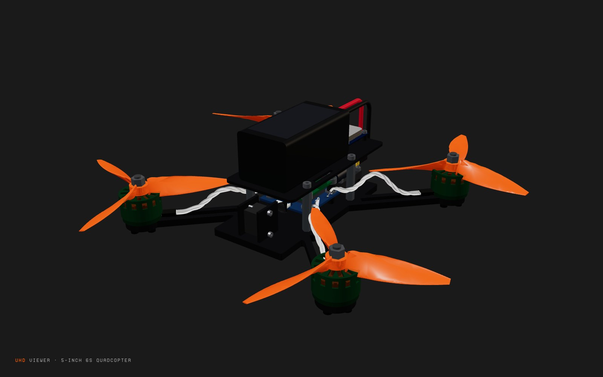

# Harnesses and their CAD

Every physical connection in the quadcopter is a UHD part. Mechanical joints
are carried by fastener harnesses (screws, spacers, nuts; see the
`harness-author` skill). Every electrical connection is carried by a **wire
harness**: a `kind: "harness"` module whose ends are connector composites
linked to the parts, and whose conductors are an internal link. Each wire
harness also has a **routed 3D artifact**: its conductors swept along a clear
path through the assembled model, with plug housings, solder joints and tinned
tips. The artifact is bound to the frames its ends land on. The viewer draws
cables only from these artifacts.

This page covers:

- how each cable was worked out, and from which sources;
- the modelling pattern;
- how the routes are generated and bound;
- how to regenerate everything;
- what the viewer does with the result;
- what is still open.

Renders: [before](renders/harnesses/before/) (rope wires drawn by the viewer)
and [after](renders/harnesses/after/) (harness artifacts from the bundle).



## 1. Audit: links and their carriers

UHD derives 20 functional links through the cables. Before this work, nine
stored electrical links had no carrier:

- the four motor phase links (`m1_phases` … `m4_phases`, ESC → motor);
- the receiver's CRSF, 5 V and GND (`rx_crsf`, `rx_power`, `rx_gnd`);
- the bulk capacitor (`bulk_cap_pos` and `bulk_cap_neg`, drawn from the pack's outputs).

None of the cables had geometry.

| Connection (derived link) | Before | Now: carrier | Ends | Conductors | Length | Status |
| --- | --- | --- | --- | --- | --- | --- |
| Battery → ESC (`battery_out~bat_in`, `battery_gnd~bat_neg`) | XT60 lead, no geometry | `xt60_lead` = `dolphinrc-xt60-battery-lead` | XT60 male ↔ pack XT60; soldered to ESC `bat_in` / `bat_neg` | 2 × 12 AWG, red/black, flat pair | 30 mm (cut from the supplied 120 mm) | modelled, routed |
| Bulk capacitor across the battery pads (`bat_in~pos`, `bat_neg~neg`) | logical links from the pack's outputs | `bulk_cap_leads` = `panasonic-eeu-fr1v471-leads` | the capacitor's own leads ↔ ESC battery pads (into the pad holes) | 2 × ø0.6 mm bare tinned, 5 mm apart | 14 mm | modelled, routed |
| ESC motor N → motor N phases (`motor_N~phases`, ×4) | logical link, rope wires in the viewer | `arm_*_leads` = `meps-phase-leads-m1…m4` | the motor's own leads (from the 10 mm heat shrink) ↔ ESC `motor_N_a/b/c` pads | 3 × 20 AWG (see 7), white, twisted | 78 mm each (cut from 140 mm) | modelled, routed |
| FC ↔ ESC (`esc_port~fc_port`, inside the stack) | SH 8-pin cable, no geometry | `stack/sh8_cable` = `dolphinrc-sh8-fc-esc-cable` | SH1.0 8-pin plug at both ends | 8 conductors, ø0.95 mm (assumed) | 50 mm | modelled, routed |
| FC ↔ O4 (10 V, GND ×2, UART5 ↔ MSP DisplayPort, S.Bus) | DJI 3-in-1 cable, no geometry | `dji_cable` = `dji-o4-3in1-cable` | SH1.0 6-pin plug at both ends (FC `dji_socket`, O4 `fc_cable_socket`) | 6: red, black, white, grey, brown, yellow | 50 mm | modelled, routed |
| FC ↔ GNSS (4.5 V, UART1, I2C1, GND) | GH6P lead, no geometry | `gnss_lead` = `matek-gh6p-gnss-lead` | GH 6-pin plug into GH6P-2; soldered to 4.5V, RX1, TX1, SCL, SDA, GND | 6 × ø1.1 mm (assumed), flat | 97 mm (cut from 200 mm) | modelled, routed |
| FC ↔ receiver (UART2 ↔ CRSF, 5 V, GND) | three logical links, no carrier | `rx_wire` = `radiomaster-rp1-crsf-wire` | soldered at both ends (receiver TX RX 5V G; FC RX2 TX2 5V GND) | 4: green, white, red, black, twisted, ø1.1 mm (assumed) | 41 mm | modelled, routed |

Mechanical joints (all carried, see the fastener stacks in
`src/harnesses/harnesses.uhd.ts`; the hardware parts are in `parts/local/`,
docs/decisions.md D-Q01):

- motor mounts ×4;
- stack (ESC and FC in their grommets);
- top plate on standoffs;
- O4 module;
- O4 camera (bought M2 × 5 screws, D-Q07);
- GPS;
- propeller on shaft ×4: the motor's M5 flanged lock nut (D-Q04).

Physical connections that remain without a carrier:

| Connection | Why |
| --- | --- |
| O4 camera ↔ transmission module | A 50 mm coax, glued at the factory, internal to the `dji-o4-air-unit` part (DJI lists it as its own spare). There is no interface link between the two bodies, so there is nothing to carry. |
| RP1 T antenna (65 mm), O4 antenna (80 mm) | Accessories on the parts' antenna interfaces. They are not linked to anything. |
| Battery strap | Not linked: the strap has no interface to mate (no strap protocol exists), so the pack and strap are placed by a placement hint and the assembly step says how the strap is threaded. The top plate's slots now take it (D-Q06). |
| Battery balance lead | Not connected in flight. |

## 2. How each cable was worked out

The parts are the source of truth. Each fact comes from a source, or is an
`assumption` trait on the harness with its reason. Fetched copies of the
sources, quotes and dates are in
[`parts/evidence/harnesses/sources.json`](../parts/evidence/harnesses/sources.json).
The parts' own evidence came with their catalog revisions
(`parts/catalog/<id>/library/parts/<id>/sources.json` and `verification.json`,
listed in `parts/origins.json`) and, for the researched capacitor, is in
`parts/evidence/panasonic-eeu-fr1v471/`.

- **XT60 lead.**
  - *Sources:* DolphinRC's product page lists "1x Red&Black 12AWG 12cm Power Cable, 1x XT60 Male plug". Their review says it is supplied with the plug fitted. AMASS XT60 drawings (XT60H-M, XT60PW) give a 16.4 × 9.2 mm face, 7.2 mm contact pitch and a 20.2 mm male housing.
  - *Pack side:* the CNHL pack's XT60 is female by convention. CNHL states neither the gender nor any lead length.
  - *Cut and lay:* the lead is cut to the routed length (assumption). It lies as a flat pair. ArduPilot advises twisting battery leads, but a twisted 12 AWG pair (6.8 mm) does not fit between the air unit and the FC's DJI plug.
- **Bulk capacitor leads.**
  - *Parts:* Panasonic's datasheet gives lead ø0.6 mm on a 5.0 mm lead space. DolphinRC's review says "each side [of the power pads] has a tiny hole to let you solder the capacitor directly down".
  - *Carrier:* the capacitor's own leads, trimmed, with no extra wire.
  - *Placement:* the capacitor lies on the air unit behind the ESC, placed by a display hint.
- **Motor phase leads.**
  - *MEPS size chart and spec table:* 150 ± 2 mm leads, 10 mm heat shrink at the motor, 3 mm pre-tinned tips.
  - *Product photos:* three loose white leads, untwisted and unsleeved.
  - *Gauge:* not stated for V2. MEPS's own 4-motor combo listing says "Lead:20#150mm" without a motor version, and one reseller says 24#. The model uses 20 AWG and records the discrepancy on the motor part.
  - *Build:* the leads are cut to length and twisted, as Oscar Liang advises for tidy leads with less interference. This is a build choice, recorded as an assumption.
  - *Harness scope:* the motor CAD now ends the leads at the heat shrink. The free leads are the harness, one definition per corner, because each corner has its own route.
- **FC/ESC SH 8-pin cable.**
  - *Sources:* DolphinRC says "SH 1.0mm 50mm-length 8pin Cable (for FC-ESC connection)", wired 1:1 (BAT GND CUR VOID M1 M2 M3 M4).
  - *Not stated:* gauge and colours. The JST SH crimp range is AWG 32–28, so the model uses 0.95 mm black conductors (assumption).
- **DJI 3-in-1 cable.**
  - *Length:* DJI specs give "3-in-1 Cable: 50 mm".
  - *Wire order and colours:* the O4 manual gives VCC red, GND black, RX white, TX grey, GND brown, S.Bus yellow.
  - *Plug type:* Oscar Liang identifies the FC-side plug as SH1.0 6-pin. The DolphinRC socket silkscreen (10V G T5 R5 G Sbus) matches it pin for pin.
  - *Not stated:* gauge. The model uses 0.8 mm (assumption).
  - *Alternative:* DolphinRC also ships a 150 mm DJI cable. The 50 mm one is enough here, with its slack laid in a service loop.
- **GNSS lead.**
  - *Sources:* Matek's page lists "JST-GH-6P to JST-GH-6P 20cm silicon wire". The photo shows red, yellow, blue, green, white and black wires.
  - *Not stated:* pin-to-colour mapping and gauge. Colours are drawn in the photo's order, and the GH crimp range is AWG 30–26 (assumptions).
  - *Build:* one plug is cut off and the lead cut to the routed length.
  - *Socket:* the lead now plugs into GH6P-2 (the rear socket). GH6P-1 faces the battery 5 mm away, which leaves no room for a plug and a bend.
- **Receiver wires.**
  - *Sources:* RadioMaster lists "1 * CRSF wire" in the package. The photo shows four twisted silicone wires (red, black, white, green) with bare tinned ends.
  - *Not stated:* gauge, length and which colour goes to which pad (assumptions).
  - *Wiring:* receiver TX goes to RX2 and RX to TX2 (ExpressLRS wiring guide), 5 V BEC and GND. The model keeps the system's UART2 choice.
  - *Alternative:* the FC's SH 4-pin receiver socket (UART6, 4.5 V rail) would work with a cut SH cable. It was not chosen, because the Betaflight configuration and the fault scenarios use UART2.

Findings where two sides did not line up:

- **ESC motor pad corners (resolved, D-Q02).** DolphinRC's manual photo (p3) and wiring drawing (p4) put the motor labels at mirrored corners. The photo shows the ESC's underside: it has no SH socket housing at the connector edge, and its battery polarity marks are mirrored against the drawing in the same way. The drawing's side, with the socket that faces the FC, is the top, and its silkscreen reads correctly when turned 180°. Seen from above with the battery pads at the rear, M1 is rear-right, as Betaflight Quad-X and the ESC CAD have it: no remap. The bench check "Motor order and spin" confirms it on the hardware.
- **Bulk capacitor on the ESC's input pads.** Soldered across `bat_in`, the capacitor's + lead would have made an input-to-input link. The capacitor's + lead now has the power role `bidirectional`: a capacitor across a rail both takes and returns charge. This is a modelling choice, stated on the part.
- **Nets with several pads.** GND, 5 V and 4.5 V each have several pads on the FC, but UHD models a net as one interface, so each has one frame. It is bound to the pad next to the peripheral pads: the right edge, beside RX1/TX1 and SDA/SCL. The receiver and GNSS GND wires share that pad.

## 3. The UHD pattern

```ts
// harness: ends are connector composites; conductors are one internal link
export const RADIOMASTER_RP1_CRSF_WIRE = routed({
  id: "radiomaster-rp1-crsf-wire", kind: "harness", topology: "wire",
  interfaces: [
    Connector({ id: "end_rx", connector: "solder_leads", pins: ["TX", "RX", "5V", "G"] }),
    Connector({ id: "end_fc", connector: "solder_leads", pins: ["RX2", "TX2", "5V", "GND"] }),
  ],
  links: [wires("end_rx", "end_fc")],                          // straight through
  traits: [
    cable(41, 4),                                              // performance { kind: "cable", length_mm, conductors, wire_gauge_awg? }
    { type: "usage_note", params: { included_with: "radiomaster-rp1-v2-elrs-2g4", source: [...] } },
    build({ colors: ["green", "white", "red", "black"], bundle: "twisted", twist_pitch_mm: 14, od_mm: 1.1 }),
    assumption("colour per pad", "...", "..."),
  ],
});

// system: each end linked to a socket, or to a link-scoped composition of pads
{ id: "rx_pads", a: { child: "receiver", interfaceId: "rx_pads", compose: { p1: "crsf_tx", p2: "crsf_rx", p3: "vcc_5v", p4: "gnd" } },
  b: { child: "rx_wire", interfaceId: "end_rx" } },
{ id: "rx_fc_pads", a: { child: "rx_wire", interfaceId: "end_fc" },
  b: { child: "stack", interfaceId: "rx_fc_pads", compose: { p1: "fc:uart2_rx", p2: "fc:uart2_tx", p3: "bec_5v", p4: "gnd" } } },
```

UHD derives the functional links through the conductors: UART2 ↔ CRSF,
5 V → VCC and GND. `checkSystem` then validates those, including the
TX-to-RX crossover. Leads that belong to a part, such as the motor's leads or
the capacitor's legs, use an `integral` end composed on the part's lead exits.
They are "included with" that part, so the BOM lists them without a separate
purchase. Each of the ten harnesses appears in [`bom.md`](bom.md).

Parts needed frames where cables land. These were added in UHD:

- FC edge pads and underside sockets;
- ESC phase pads per leaf, battery pads and FC socket;
- O4 cable socket;
- CNHL discharge lead and XT60;
- RP1 V2 CAD and pads (new);
- M9N GH6P socket faces (from the vendor STEP);
- capacitor leads (`parts/local/panasonic-eeu-fr1v471/part-cad/bulk_capacitor.py`, run through the `cad` capability).

Positions follow the manuals' drawings, and pitches are representative.

## 4. Routed geometry and its binding

`@protoboardai/ext-harness-cad` is each wire harness's `cad` provider: every
cable has a provider directory `src/harnesses/<harness id>/` with a
`cad.config.ts` naming it. `protoboard run cad:generate --module <id>` does
steps 1–3 and the conductor paths of step 4, and writes the route, the
native design, to `harness-cad/route.json`. `cad:export` builds the bodies
from it into `out/`. `protoboard run harness-cad` does both for every cable.
Code is in `packages/ext-harness-cad/`.

1. **Job** (`lib/job.ts`).
   - Assemble the model as the viewer does: UHD `assemble` from the display root, with display placements for the battery, receiver and capacitor.
   - List every placed body's GLB and every piece of hardware as obstacles.
   - Resolve each wire harness's two ends through `linkEndFrames` to world positions, one per conductor. A composed end gives one pad per position, in slot order. A socket gives positions along its xAxis at the connector's pitch.
2. **Obstacle map** (`py/route.py`).
   - Voxelise the bodies at 1 mm, each filled solid.
   - Build a clearance field (Euclidean distance transform) and a "supported" field (solid just below).
3. **Route** (`py/harness_cad.py`). The route starts where each end's wires leave it:
   - *Plug:* out of the housing's rear along the socket normal.
   - *Solder pad:* up and tilted toward the side with the most room.
   - *Integral lead:* straight on.

   A* runs over cells the bundle fits in. Resting on something costs 1.0 per mm, touching a surface 1.5, and free air 2.6, so cables lie on the frame. The path is then shaped:
   - shortened by line of sight;
   - corners filleted to 4 × the stiffness diameter (the bundle for twisted cables, one conductor for flat ones);
   - smoothed and faired with a smoothing spline.

   The path is then **fitted to the modelled length**:
   - less than about 3 mm of slack: taken up by a gentle bow;
   - more: a service loop (U or V) pulled out into clear space, sized by bisection;
   - modelled length shorter than the shortest clear route: reported as "does not reach".
4. **Conductors and terminations.**
   - *Conductors:* twisted cables are swept as helices around the route at their pitch. Flat ones lie side by side, turned flat against the nearest surface. Each conductor fans from its pin into the bundle.
   - *Collision relaxation:* conductors are pushed clear of any solid by relaxation. The check then reports:
     - the closest approach of any conductor to a solid (negative means inside, named by body);
     - the tightest bend away from the terminations, against the 2.5 × minimum;
     - the route length.
   - *Bodies:* plug housings, solder joints and tinned tips are added.
   - *Exports* (`cad:export`, from the route file): `out/body.glb` (own writer: one named node and material per conductor or termination), `out/body.step` (build123d sweeps) and `out/body.manifest.json`.
   - *Order:* harnesses are routed rigid ends first, then thickest first, and each routed cable becomes an obstacle for the next. Generating one cable routes the cables before it again, in memory, so its route does not depend on what was generated before.

**Binding.** The manifest records each end's frame: the part's combined
frame, with its normal reversed. The geometry is written in assembly-root
coordinates. `routed(def)` (`src/harnesses/routes.ts`) does two things:

- attaches the route, STEP, GLB and manifest as the harness's artifacts;
- gives each end interface its frame, with a feature reference to the termination bodies (signature from the manifest).

UHD `assemble` then places each harness from its first end's part and checks
the other end (`Assembly.harnesses`). An end more than 0.5 mm or 5° from its
part is a stale-route warning. Each cable's `cad:check` reports:

| Code | When |
| --- | --- |
| `HARNESS_NOT_ROUTED` | no route yet |
| `HARNESS_ROUTE_LENGTH` | route length ≠ modelled length |
| `HARNESS_ROUTE_STALE` | an end no longer meets its part, or the route was generated for other ends, conductors, length or build |
| `HARNESS_EXPORT_STALE` | `out/` was exported from an earlier route |
| `HARNESS_ROUTE_WARNING` | the generator's own findings |

The extension's `routes` check reports a wire harness with no `cad.config.ts`
(`HARNESS_NOT_CONFIGURED`).

Current results (all ten clear, no warnings; regenerated for release 0.1.0 with the
stack's grommets, the prop nuts and the moved strap slots as obstacles, and
with the M9N's vendor body from catalog revision 3, D-Q13):

| Harness | Length | Shortest route | Fit | Lay | Tightest bend / min | Clearance |
| --- | --- | --- | --- | --- | --- | --- |
| `stack/sh8_cable` | 50 | 14.8 | service loop | flat 8 × 0.95 | 3.02 / 2.5 | 4.51 |
| `dji_cable` | 50 | 32.1 | service loop | flat 6 × 0.8 | 2.95 / 2.5 | 1.49 |
| `xt60_lead` | 30 | 29.4 | shortest | flat 2 × 3.4 | 35.1 / 8.5 | 0.06 |
| `gnss_lead` | 97 | 96.4 | shortest | flat 6 × 1.1 | 9.18 / 2.75 | 0.06 |
| `arm_*_leads` ×4 | 78 | 69.9 | bow | twisted 3 × 1.7, 24 mm pitch | 8.45 / 5.49 | 1.07–1.25 |
| `bulk_cap_leads` | 14 | 14.2 | shortest | 2 × ø0.6 bare, 5 mm apart | 23.3 / 2.5 | 0.36 |
| `rx_wire` | 41 | 39.8 | shortest | twisted 4 × 1.1, 14 mm pitch | 54.3 / 3.98 | 0.06 |

The GNSS lead keeps its 97 mm cut length: with the module's body present its
shortest route was 96.2 mm; without it the router finds 89.9 mm and bows the
slack. Regenerate it, and the cables after it, once the body is back.

All values are in mm. The bend rule is a representative one for fine-strand
silicone wire in a static installation. Clearance is the conductor surface to
the nearest solid, outside the terminations.

The routing forced several layout decisions:

- The O4's cable socket sits on the module's right side.
- The capacitor lies on the air unit, left of centre.
- The receiver is taped under the top plate, rear right.
- The battery's discharge lead loops down behind the pack into an XT60 that faces forward between the plates.

These are design values, marked as such in `@deltarobotics/uhd`
`library/cad/params.ts` and the display notes.

## 5. Regenerate

```bash
# UHD parts and their CAD (sibling repo)
cd ../uhd
npx tsx library/cad/params.ts
.venv-cad/bin/python library/cad/py/build_all.py        # every generated part body (parts.py: FC, ESC, O4, CNHL, RP1, motor …)
.venv-cad/bin/python library/cad/rebind.py library/parts/<id>.ts library/parts/<id>/artifacts/cad/<name>.manifest.json   # after a reviewed change
npm run build && npm run build:library
# then publish each changed part as its next catalog revision (protoboard-cloud
# README, "Publish one part from a directory"); the seed leaves changed parts alone

# this project (the parts service running: PROTOBOARD_CLOUD_URL, default http://localhost:8787)
cd ../protoboard-stack/examples/quadcopter-5in
npx protoboard parts update                       # what the catalog recommends, and what it changes
npx protoboard parts update <id> --to <revision>  # re-pin each changed part deliberately
npx protoboard tools install cad                  # once: .protoboard/tools/cad (or PROTOBOARD_PYTHON=<python>)
# every body through the cad capability: per module, cad:generate then cad:export
# (the release traces each module's out/ to its own cad:export record)
for m in $(npx protoboard capabilities --format json | jq -r '.modules[] | select(.capability=="cad") | .module'); do
  npx protoboard run cad:generate --module $m && npx protoboard run cad:export --module $m
done
# or, while iterating: run frame-cad (plates), hardware-cad (screws, nuts, spacers, standoffs), harness-cad (cables)
npx protoboard check && npx protoboard build && npx protoboard run bom
```

- `protoboard run cad:generate --module <id>` then `cad:export --module <id>` regenerates one cable (or `harness-cad --input harness=<id>`). The cables before it in the routing order are routed again, in memory, as obstacles; the cables after it are not touched, so regenerate them too if this one moved.
- The GNSS body would be Matek's vendor GLB, which the pinned catalog revision does not carry (D-Q13). The committed routes were made without it, so any clone reproduces them; once a revision with the body is pinned, regenerate the GNSS lead and the cables routed after it.
- A cut-to-length cable's `length_mm` (`src/harnesses/harnesses.uhd.ts`) should be about the op's reported shortest route. A bought cable keeps its listed length, and the generator lays in the slack.
- The routing job is written to `.protoboard/cache/harness-cad/route/job.json` while the generator runs.

## 6. In the viewer

`uhd-viewer` draws each routed harness from the bundle:

- its GLB, placed by `assembly.harnesses`;
- the generator's colours, with a satin, metal or plastic surface per node kind;
- labels from `display.json` `labels.harnesses`, or the instance name, with a cable summary.

Clicking a cable opens its inspector: cable, routed length and fit, bend,
clearance, each end's ANCHOR/MATCHES/STALE state, and artifacts. The toolbar's
CABLES toggles them. Cables fade out when the model explodes, because they are
routed for the assembled model. The old rope wires, simulated from interface
frames outside UHD, are gone.

Stills:

```bash
cd ../uhd-viewer
node scripts/capture-cad-stills.mjs <out-dir>
```

The script expects the viewer at `localhost:5178`. The stills in
`renders/harnesses/after/` were last taken for release 0.1.0 after the M9N-5883
re-pin: `npx protoboard dev --no-watch` wrote
`.protoboard/build/uhd-bundle.json`, `uhd-viewer serve` served it (the dev
page keeps a live connection open, so a `networkidle0` wait never settles on
it), and the script's URL pointed at that server: shots 01–15, plus 16, the
GNSS lead's harness inspector in 3D (`?view=3d&harness=gnss_lead`), saved
as JPEG. `node scripts/check-render.mjs` on the same server reported no
failed request.

## 7. Part bodies

The parts that cables route around also got more realistic bodies. They are
generated in `@deltarobotics/uhd` `library/cad/py/parts.py` with the same
artifact conventions, and their interface features are unchanged.

- **MEPS NEON 2207 V2.** A hollow bell with the twelve-spoke top and a ring of
  side windows, stator and windings visible inside, base, shaft, and the
  lead exit in a 10 mm heat-shrink sleeve. Colours follow the product photo:
  lime bell, white leads.
- **HQProp Ethix S5.** Three blades lofted from elliptical sections whose
  pitch angle follows the stated 4 in pitch. Chord and thickness are
  representative. One handedness is drawn for all four props. The listed
  colour is light grey polycarbonate.
- **CNHL 1100 6S.** Rounded wrap with a label panel, the discharge lead
  looping into the XT60, and the pack centred between the strap slots.

The strap itself is not drawn (the catalog part has no body). The top
plate's two slots are now 22 × 3 mm, long in X, either side of the pack's
centre, so the strap goes down one slot, under the plate, up the other and
round the pack's cross-section (D-Q06).

The mounting hardware's nominal bodies (screws, nuts, spacers, standoffs,
grommets, prop nuts) come from `@protoboardai/ext-frame-cad` through the `cad`
capability, one `cad.config.ts` per part in `parts/local/<id>/`.

## 8. Still open

Resolved for release 0.1.0 (docs/decisions.md): the ESC motor-pad corners (D-Q02),
the prop nut as a fastener stack (D-Q04), the strap slot layout (D-Q06).

- **Motor lead gauge.** 20 vs 24 AWG; the sources disagree and the photo
  does not settle it (D-Q03). The CAD draws 20 AWG; the bring-up check
  "Motor lead gauge" measures it at the build.
- **Unstated by their makers, drawn from assumptions:**
  - gauges of the SH 8-pin cable, DJI cable, GNSS lead and receiver wires;
  - colours of the SH 8-pin cable;
  - colour per pin of the GNSS lead and receiver wires;
  - XT60 housing colours;
  - CNHL discharge-lead length and exit position (designed for this build);
  - the O4 cable socket's position and size;
  - the grommets' size and the prop nut's size (nominal bodies, data gaps
    on the parts).
- **Placement by display hints.** The receiver, capacitor and battery are placed by display hints, not by a modelled mount; the assembly steps say how each is held (foam tape, strap). The stale-route check sees them only through those hints. UHD core's `uhd/assemble` does not read display hints, so there these ends report `unplaced`.
- **Pads per net.** One pad per net (§2).
- **FC CAD envelope.** The FC's component envelope uses the 8 mm the review gives for the whole stack height. Real components are lower, so the envelope is conservative for routing.
- **Propeller handedness.** One handedness is drawn for all props (the CW and CCW variants share one GLB).
- **GNSS body (resolved).** Catalog revision 3 of the M9N-5883 carries Matek's STEP and the GLBs converted from it (distribution "unknown": keep them in the team). With the body as an obstacle the GNSS lead's shortest clear route is 96.4 mm of its 97 mm, so it no longer bows; the cables routed after it did not change (D-Q13).
- **Before renders.** Shots 06–12 in `renders/harnesses/before/` show faded label remnants from an early version of the capture script. They are otherwise the old viewer's output.
