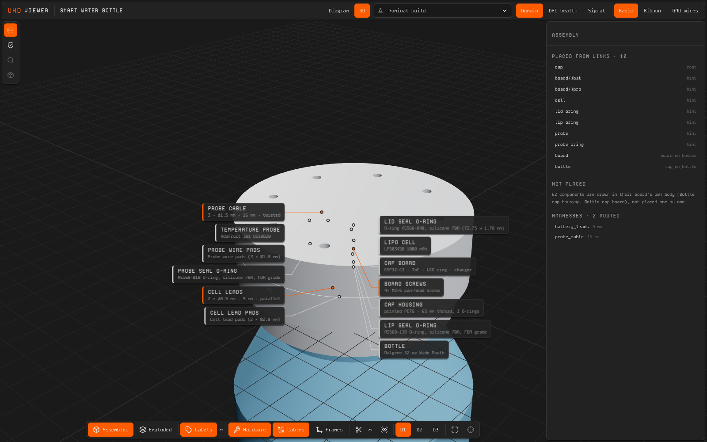
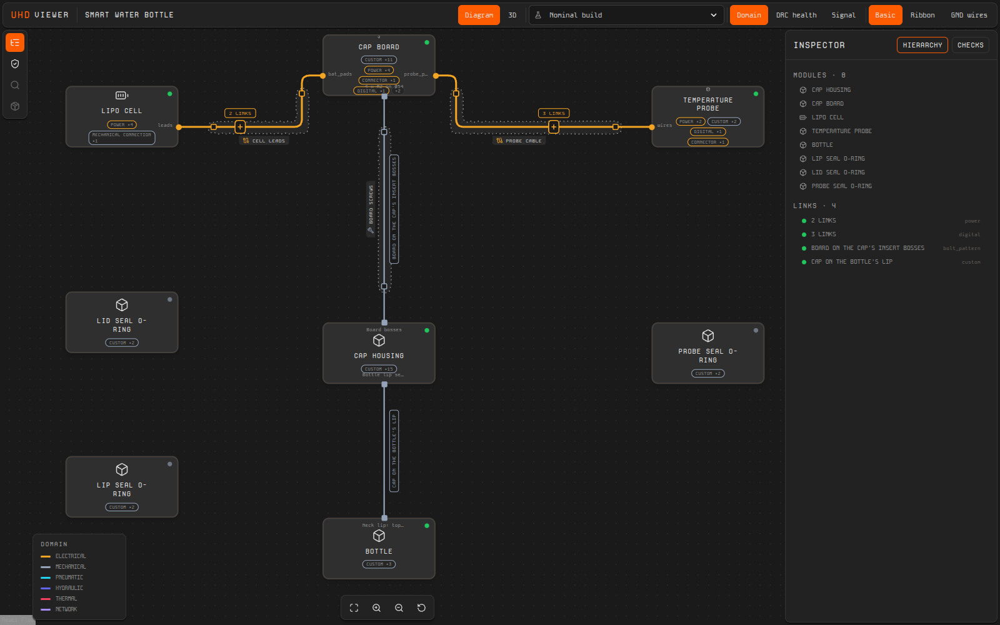
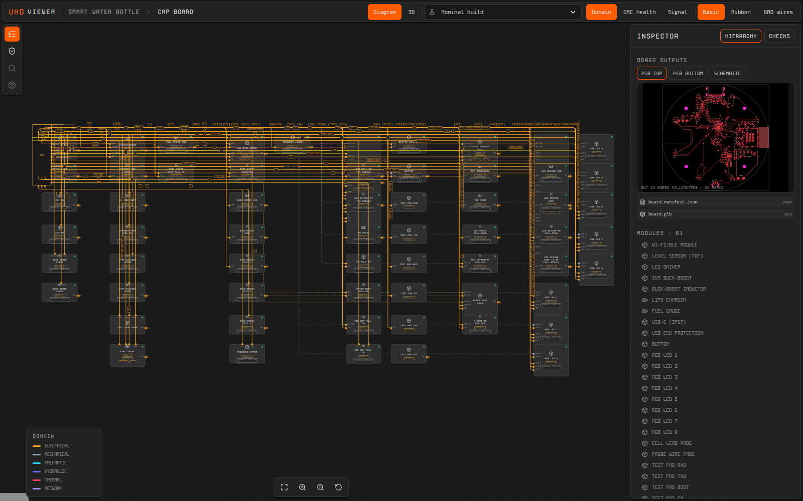
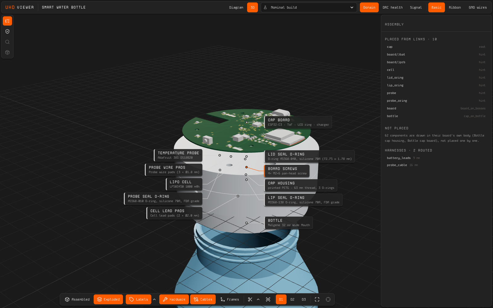
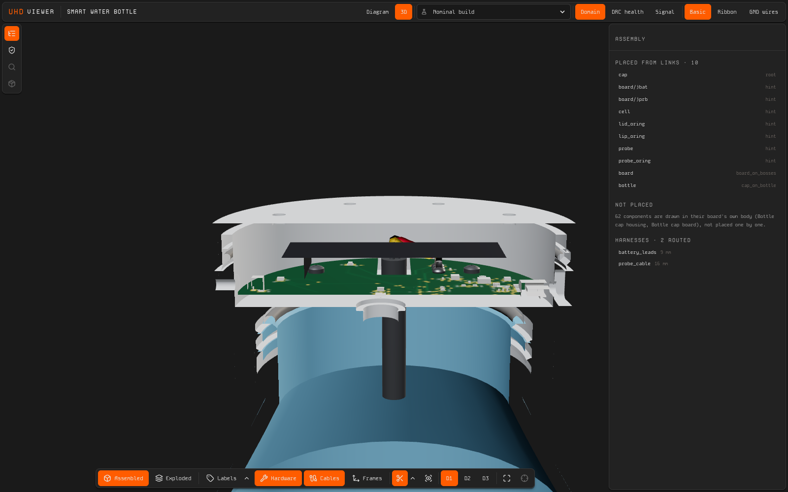

# smart-bottle

Protoboard reference project: a sensor cap for a Nalgene 32 oz Wide Mouth
bottle. It measures the water level by time of flight and the water
temperature with a stainless probe, shows reminders on a ring of eight RGB
LEDs, and syncs over Wi-Fi.

It exercises the three design capabilities on one product:

- a custom four-layer board, designed through `circuit` (@protoboardai/ext-tscircuit);
- a sealed printed cap, designed through `cad` (@protoboardai/ext-enclosure-cad),
  that screws onto a purchased part's thread;
- its firmware configuration, through `firmware` (@protoboardai/ext-esp-idf).

Nothing here is physically made in v0.1: no board is ordered, nothing is printed.



| | |
| --- | --- |
|  |  |
|  |  |

The screenshots come from `protoboard dev`, with a uhd-viewer built against
this branch's UHD (uhd 53a6166: `atRail` and the composite pairing), so the
viewer reports what `protoboard check` does: 0 errors. A viewer built
against an older UHD shows two stale `LINK STATE` findings.

## What is in the system

| Instance | What | Where it comes from |
| --- | --- | --- |
| `cap` | Printed PETG cap, Ø80 mm: base, bayonet lid and button plunger, 63 mm neck thread, three O-ring glands (the lid's radial on the base's collar), ToF window, USB-C port, eight light pipes | `src/enclosures/bottle-cap/`, generated by ext-enclosure-cad |
| `board` | Cap board: Ø70 mm, four layers, 0.6 mm thick, 61 components (ESP32-C3-MINI-1-H4X, VL53L4CD, LP5024 and eight RGB LEDs, TPS63020, MCP73831, MAX17048, USB4720, USBLC6) | `src/boards/bottle-cap/`, routed by ext-tscircuit |
| `cell` | LP503450 1000 mAh LiPo | `parts/local/` (project-researched) |
| `probe` | Adafruit 381 DS18B20 probe, stainless tube | `parts/local/` |
| `bottle` | Nalgene 32 oz Wide Mouth (63 mm finish) | `parts/local/` |
| O-rings | AS568-138 (lip), AS568-040 (lid), AS568-010 (probe) | catalog |
| `battery_leads`, `probe_cable` | The cell's leads and the probe's cable, routed in the cap | `src/harnesses/`, routed by ext-harness-cad |
| `board_hardware` | 4 M2 × 6 screws into ruthex heat-set inserts (the bayonet lid needs no screws) | `src/harnesses/` |

Parts come in three tiers:

- 19 catalog parts, vendored from the development catalog and pinned in
  `parts/origins.json`;
- three parts researched in this project, with evidence in `parts/evidence/`;
- the designed modules in `src/`.

Passives are catalog series parts, placed per value through `overrides`, so
every R and C has its own MPN.

## Results

| Brief target | Result | Shown by |
| --- | --- | --- |
| Battery life ≥ 30 d (samples every minute, hourly sync) | 89 d estimated (38 d with poor Wi-Fi) | `scripts/power-budget.ts` → `docs/power-budget.json` |
| Charge ≤ 5 h | about 4.0 h at 303 mA (2.5 h constant current, about 1.5 h taper, assumed) | same |
| Cap Ø ≤ 80 mm | **Met**: Ø80.0 mm overall, 23.1 mm above the lip; a bayonet lid replaces the six lid screws | `docs/decisions.md` D-B09 |
| Cap weight ≤ 120 g | met on an estimate (board mass estimated, not weighed) | `docs/decisions.md` requirements trace, D-B20 |
| Faults caught | 6 of 6 system scenarios, 5 of 5 firmware cases | `src/scenarios.ts`, `scripts/firmware-scenarios.ts` |

`protoboard check` reports 0 errors and 2 warnings. The
[decisions](docs/decisions.md#warnings-dispositioned) explain each warning.

## Documents

- [`docs/brief.md`](docs/brief.md): purpose, targets, acceptance criteria.
- [`docs/component-selection.md`](docs/component-selection.md),
  [`docs/system.md`](docs/system.md),
  [`docs/power-budget.md`](docs/power-budget.md) and
  [`docs/open-questions.md`](docs/open-questions.md): the design inputs.
- [`docs/decisions.md`](docs/decisions.md): decisions D-B01..D-B21, the
  requirements trace, and the warning dispositions.
- [`docs/smart-bottle-datasheet.pdf`](docs/smart-bottle-datasheet.pdf) and
  [`docs/smart-bottle-assembly-guide.pdf`](docs/smart-bottle-assembly-guide.pdf):
  generated by ext-docs from the model and `docs/docspec.ts`. Battery life is
  stand-in test data (`docs/test-data/`), watermarked until it is measured.

## Rebuild it

From the repository root, run `npm install` once. You also need:

- Python with build123d: `npx protoboard tools install cad`, or set
  `PROTOBOARD_PYTHON`;
- Google Chrome and poppler, for the documents and the release;
- nothing for the fonts: Kode Mono ships with ext-docs.

Then run, in this folder:

```sh
npx protoboard check                                          # 0 errors, 2 warnings

# board: placement and routing (~3 to 6 min), then the standard outputs and the firmware config
npx protoboard run circuit:generate --module bottle-cap-board
npx protoboard run circuit:export   --module bottle-cap-board
npx protoboard run firmware:generate --module bottle-cap-board
npx protoboard run firmware:export   --module bottle-cap-board

# cap, routed against the board, cell and probe; then the two cables
npx protoboard run cad:generate --module bottle-cap-enclosure
npx protoboard run cad:export   --module bottle-cap-enclosure
npx protoboard run harness-cad                                # route both cables
npx protoboard run cad:export --module bottle-battery-leads   # the release traces each cable's out/ to a cad:export
npx protoboard run cad:export --module bottle-probe-cable

# every viewer tab of every level draws (Diagram, 3D, Schematic, PCB, BOM, ...), each opened once headless
npx protoboard views check

# scenarios, power budget, firmware faults
npx tsx node_modules/@protoboardai/ext-hardware/skills/system-compose/scripts/scenarios.ts
# (inside the stack's npm workspace: ../../node_modules/@protoboardai/ext-hardware/...)
npx tsx scripts/power-budget.ts
npx tsx scripts/firmware-scenarios.ts

# documents, then the Manufacturing Package (needs a committed tree)
npx protoboard run tech-docs && npx protoboard run tech-docs-verify
npx protoboard release --check && npx protoboard release      # release/0.1.0/ (gitignored)

# viewer and README screenshots
npx protoboard dev --port 5197 --no-watch &
node scripts/viewer-screenshots.mjs http://127.0.0.1:5197/
```

Run the screenshot script before `tech-docs`. tech-docs records everything in
`docs/images/` among its outputs, and the release refuses an output that has
changed since its operation wrote it.

The release has three units:

- `units/board/`: Gerbers, drill files, pick-and-place and BOM, all with
  per-placement passive values. Every land pattern is the maker's
  recommended one, verified against its drawing, with the receptacle's
  plated stake slots and tag holes and the switch's guide-boss holes (D-B07);
  no via sits in a pad (D-B14). The order has no hold.
- `units/cap/`: STEP, plus STL and 3MF for each printed part. The cap unit
  ends at the printed parts with the four inserts set and the light pipes
  filled (D-B19).
- `system/`: final assembly (plunger, board, probe, cell, O-rings, lid, then
  the bench test and the bottle), the cable cut lists and the ordering list.

Each unit has a spec sheet, BOM, work order, assembly guide and test plan.
`00-overview.pdf` and `index.html` sit at the top of the package.

Every run writes a record in `operations/`.

## Layout

See [`AGENTS.md`](AGENTS.md).
