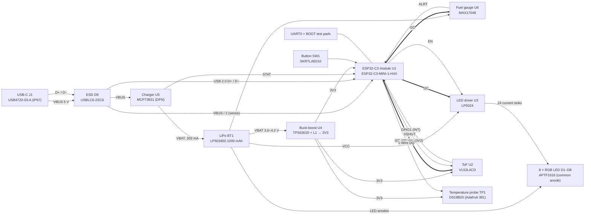
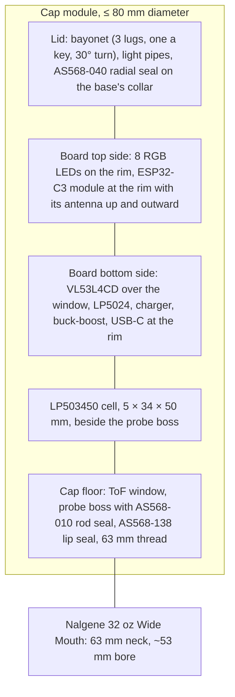

# Smart water bottle: system

Block diagram, power rails, pin map, bus addresses and physical layout.
Source tags ([B1], [B3] …) refer to the
[component selection sources](component-selection.md#sources). Pad numbers
are the module's pads from [B1] Table 3-1. The pin map is a proposal for the
board track.

## Block diagram

## Power rails

| Rail | Source | Range | Loads | Notes |
| --- | --- | --- | --- | --- |
| VBUS | USB-C | 5 V nominal | U5 VDD (3.75–6 V [B10]), D9, VBUS sense divider | Present only while charging |
| VBAT | Cell BT1 through its PCM | 3.0–4.2 V in use; cell rated 2.75–4.20 V [B12] | U4 VIN (1.8–5.5 V [B8]), U6 VDD (2.5–4.5 V [B11]), U3 VCC (2.7–5.5 V [B6]), LED anodes | Firmware cut-off 3.40 V (see [power budget](power-budget.md)) |
| 3V3 | U4 TPS63020, PS/SYNC low (power save) | 3.3 V | U1 3V3 (3.0–3.6 V, supply ≥ 0.5 A [B1]), U2 AVDD and IOVDD (2.6–3.5 V, 1.6–3.5 V [B3]), TP1 VDD (3.0–5.5 V [B5]), I2C and 1-Wire pull-ups | |

**Assumption:** U4's EN is tied to VBAT (always on). The ESP32-C3 deep sleep
(5 µA [B1]) is lower than the cost of a supervisor that would switch the rail.
Switching U4 off would also need a wake path that does not depend on the
ESP32-C3 (OQ-B3).

## Pin map (U1, ESP32-C3-MINI-1-H4X)

| Function | Peripheral pin | GPIO | Module pad | Deep-sleep wake [B2] | Pull / note |
| --- | --- | --- | --- | --- | --- |
| ToF XSHUT | U2 pin 5 XSHUT | GPIO0 | 12 | RTC pad (hold) | 10 kΩ pull-down so U2 stays in hardware standby during reset and deep sleep; the pin is held low with the RTC hold function [B2]. ST recommends a pull-up only when the host state is unknown [B3] §1.4; here the host state is defined |
| ToF interrupt | U2 pin 7 GPIO1 | GPIO1 | 13 | yes | Open drain, 10 kΩ to 3V3 [B3] |
| I2C SCL | U2, U3, U6 | GPIO2 | 5 | — | 4.7 kΩ to 3V3; also gives the recommended pull-up on strap pin GPIO2 [B1] Table 4-3 |
| User button | SW1 to GND | GPIO3 | 6 | yes | 10 kΩ to 3V3. Must be on GPIO0–5 to wake from deep sleep [B2] |
| 1-Wire DQ | TP1 data | GPIO4 | 18 | — | 4.7 kΩ to 3V3 [B4, B5] |
| LED driver EN | U3 EN | GPIO5 | 19 | RTC pad (hold) | 100 kΩ pull-down: U3 in shutdown (0.2 µA [B6]) unless driven |
| Fuel gauge ALRT | U6 ALRT | GPIO6 | 20 | no (light sleep only) | Open drain, 10 kΩ to 3V3 [B11]; read on each timer wake |
| Charger STAT | U5 STAT | GPIO7 | 21 | no | Tri-state [B10]; read with internal pull-up, then pull-down |
| I2C SDA | U2, U3, U6 | GPIO8 | 22 | — | 4.7 kΩ to 3V3; holds strap pin GPIO8 high, as download boot requires [B1] Table 4-3 |
| BOOT strap | test pad | GPIO9 | 23 | — | 10 kΩ to 3V3 (SPI boot = 1); pad to GND for download mode [B1] |
| VBUS sense | VBUS through 68 kΩ / 100 kΩ (was 100 kΩ / 100 kΩ, decisions D-B17) | GPIO10 | 16 | no | 2.83 V at 4.75 V and 3.27 V at 5.5 V: above VIH (2.46 V) and within the 3.28 V rail |
| USB D− / D+ | J1 via D9 | GPIO18 / GPIO19 | 26 / 27 | — | USB Serial/JTAG [B1] |
| UART0 RX / TX | test pads | GPIO20 / GPIO21 | 30 / 31 | — | Recovery and logging |
| EN | RC reset | EN | 8 | — | 10 kΩ to 3V3, 1 µF to GND (Assumption: values, per Espressif's power-up note [B1]) |
| 3V3 | U4 output | — | 3 | — | |
| GND | — | — | 1, 2, 11, 14, 36–53 | — | |

Every GPIO the module brings out is used; GPIO10 is the first to free if a pin
is needed (VBUS can be inferred from STAT instead).

## I2C bus

One bus on 3V3, 400 kHz (the MAX17048's limit [B11]).

| Device | 7-bit address | Fixed or strapped | Source |
| --- | --- | --- | --- |
| LP5024 (U3) | 0x28 | ADDR1 = ADDR0 = GND | [B6] Table 7-2 |
| VL53L4CD (U2) | 0x29 | default | [B3] |
| MAX17048 (U6) | 0x36 | fixed | [B11] |
| LP5024 broadcast | 0x3C | always answers | [B6] Table 7-2 |

No two addresses collide. **Conflict to avoid:** strapping the LP5024 with
ADDR0 = VCC gives 0x29 [B6], the VL53L4CD's default; ADDR0 must stay on GND.
The VL53L4CD address can be reprogrammed in software, but the change is lost
at every power-down [B3], so the design does not rely on it.

Voltage compatibility with 3.3 V pull-ups: LP5024 SDA/SCL tolerate 6 V and
read VIH ≥ 1.4 V [B6]; VL53L4CD I/Os are failsafe up to IOVDD = 3V3 [B3];
MAX17048 pins tolerate 6 V [B11]. The LP5024 and MAX17048 are on VBAT, so
their pins see a 3.3 V bus from a 3.0–4.2 V supply, which their absolute
ratings allow.

## Physical layout (proposal for the enclosure and board tracks)

| Interface | Board / cap side | Other side | Kind |
| --- | --- | --- | --- |
| Bottle thread | Internal 63 mm thread in `bottle-cap-body` | Nalgene neck finish (63 mm, 6 TPI per SPI; semi-buttress per Nalgene) [B17, B21] | Threaded mate |
| Bottle seal | AS568-138 in a face groove | Bottle lip | Face seal |
| Lid seal | AS568-040 in the lid | Cap body rim | Face seal |
| Probe | Boss with AS568-010 rod seal | TP1 stainless tube, Ø6 mm [B4] | Radial seal; tube protrudes into the bottle |
| Probe cable | 3 solder pads (VDD, DQ, GND) | TP1 cable, cut to length [B4] | Harness `bottle-probe-cable` |
| Cell | 2 solder pads | Cell leads | Harness `bottle-battery-leads` |
| ToF window | U2 on the board's bottom side, looking down | Window disc in the cap floor | Optical (OQ-B1) |
| USB-C | J1 at the board rim (mid-mount cut-out) | Opening in the cap wall | IP67 receptacle, wall seal (OQ-B4) |
| Button | SW1 at the board rim | Plunger and membrane in the cap wall | Mechanical (OQ-B9) |
| LEDs | D1–D8 on the board's top rim | Light-guide ring in the lid | Optical (OQ-B7) |
| Antenna | U1 at the rim, keep-out kept free of copper [B1] | Plastic only above and beside it; water and the cell below | RF (OQ-B6) |
