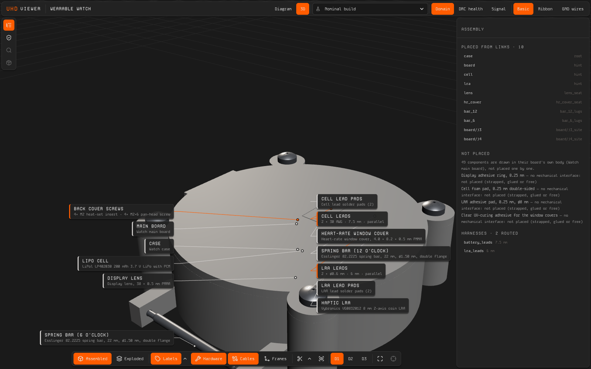

# wearable-watch

A Protoboard Stack reference project: a smartwatch with a round display, a
custom main board and a 3D-printed case.

The quadcopter is built from purchased modules. The watch exercises the parts
of the Stack that the quadcopter does not use:

- a board designed through the **circuit** capability (`@protoboardai/ext-tscircuit`);
- a case generated from its interfaces through the **cad** capability
  (`@protoboardai/ext-enclosure-cad`);
- a Zephyr board definition generated through the **firmware** capability
  (`@protoboardai/ext-zephyr`).

The whole system is described in UHD (`@deltarobotics/uhd`): parts,
interfaces, nets and links. Every generated file traces back to that
description.



## The watch

| | |
| --- | --- |
| MCU and radio | Raytac MDBT50Q-1MV2 (nRF52840, BLE, chip antenna) |
| Display | EastRising ER-TFT1.28-1: 1.28-inch round, 240 × 240, GC9A01; soldered to the board by its FPC |
| Sensors | Bosch BMI270 IMU, ADI MAX30102 heart rate behind a window in the back cover |
| Haptics | TI DRV2605L driving a Vybronics VG0832012 LRA |
| Power | LiPol LP402030 cell (200 mAh); MCP73831 charger from USB-C at 83 mA; MAX17048 fuel gauge; TPS7A02 regulators for 3.0 V and 1.8 V |
| Controls | Two side-push buttons with printed plungers |
| Board | 41 mm round, 4 layers (both inner layers ground pours), 0.8 mm, ENIG; routed with 0 DRC errors |
| Case | Round PETG case, 13.49 mm thick, 22 mm spring-bar lugs, back cover held by four M2 screws into heat-set inserts |
| Battery life | 12.1 days of typical use, 119 days standby; the brief asks for 5 and 30 days ([power budget](docs/power-budget.md)) |

`protoboard check` reports 0 errors and 1 warning (the cell leads' slack); it and the 19 infos are
explained in [decisions.md](docs/decisions.md#what-protoboard-check-still-reports).

## Documents

- [`docs/brief.md`](docs/brief.md): purpose, functions, targets, constraints,
  acceptance.
- [`docs/component-selection.md`](docs/component-selection.md): every
  purchased part, with its alternatives, cited facts and tier.
- [`docs/system.md`](docs/system.md): block diagram, rails, pin map, I2C
  addresses.
- [`docs/power-budget.md`](docs/power-budget.md): current per mode, use
  assumptions, battery life checked against the brief
  ([`power-budget.json`](docs/power-budget.json)).
- [`docs/decisions.md`](docs/decisions.md): design decisions D-W1..D-W14, and
  every diagnostic `check` still reports.
- [`docs/harnesses-and-cad.md`](docs/harnesses-and-cad.md): stack-up, where
  each geometry comes from, the lead harnesses.
- [`docs/open-questions.md`](docs/open-questions.md): what is still open.
- Spec sheet and assembly guide, generated from the model:
  - [`docs/wearable-watch-datasheet.pdf`](docs/wearable-watch-datasheet.pdf)
  - [`docs/wearable-watch-assembly-guide.pdf`](docs/wearable-watch-assembly-guide.pdf)

Viewer screenshots are in [`docs/images/viewer/`](docs/images/viewer/):

- `01-system-diagram.png`: the system diagram.
- `02-board.png`: the board view, with its nets and the PCB.
- `03-assembled-labels.png`: the assembled watch with labels.
- `04-section.png`: a section through the case.
- `05-assembled-back.png`: the back cover.

## Layout

| Path | What |
| --- | --- |
| `src/watch.uhd.ts` | The root system: case, board, cell, LRA, spring bars, lead harnesses, back-cover screws, window covers, assembly materials, and their links; its battery-life figures come from `src/power-budget.ts` |
| `src/boards/watch-main/` | The main board: `watch-main.uhd.ts` (parts, nets, passives by value, edge), `lands.uhd.ts` (the lead and SWD pads), `circuit.config.ts`, `firmware.config.ts`, the native design in `tscircuit/`, the outputs in `out/`, the Zephyr board in `zephyr/`, and `antenna-check.ts` |
| `src/enclosures/watch-case/` | The case: its features (`watch-case.uhd.ts`), `cad.config.ts`, the build123d design and `out/` (STEP, GLB, STL, 3MF, manifest), and the bound frames (`watch-case.bind.ts`); `glazing.uhd.ts` holds the display lens and the heart-rate cover, cut from the outlines the case provider writes |
| `src/harnesses/` | The cell and LRA lead harnesses, routed by ext-harness-cad, and the back-cover screw kit |
| `src/materials.uhd.ts` | Assembly materials: the cell foam pad, the LRA adhesive pad, the display adhesive ring and the cover adhesive |
| `src/scenarios.ts` | Seven fault scenarios; each must be caught |
| `src/power-budget.ts` | Battery life against the brief |
| `parts/catalog/` | Purchased parts from the Protoboard parts catalog, pinned in `parts/origins.json` |
| `parts/local/` | Parts researched in this project (display, cell, spring bar, 20 pF capacitor), with their CAD; evidence in `parts/evidence/` |
| `.protoboard/display.json` | Placements of the parts held inside the case (board, cell, LRA) and the diagram layout |
| `operations/` | Records of every generate, export and release |

## Rebuild

From a checkout of the Stack, with `../uhd` next to it, run these from this
folder. The CAD steps need a Python with build123d: either run
`npx protoboard tools install cad`, or set `PROTOBOARD_PYTHON`. The documents
and the release need Chrome and poppler.

```sh
npm install                                     # at the repository root
npx protoboard check                            # 0 errors, 1 warning

# the board: native design, routing, outputs, firmware
npx protoboard run circuit:generate --module watch-main-board
npx protoboard run circuit:export   --module watch-main-board
npx protoboard run firmware:generate --module watch-main-board
npx protoboard run firmware:export   --module watch-main-board
npm run antenna-check                           # no copper near the antenna

# the case, generated around the board, display, cell and LRA
npx protoboard run cad:generate --module watch-case
npx protoboard run cad:export   --module watch-case

# the leads, routed through the assembled model
npx protoboard run cad:generate --module watch-battery-leads
npx protoboard run cad:export   --module watch-battery-leads
npx protoboard run cad:generate --module watch-lra-leads
npx protoboard run cad:export   --module watch-lra-leads

# checks against the brief
npm run power-budget                            # battery life, peak and charge current
npm run scenarios                               # every fault scenario is caught

# documents and the Manufacturing Package
npx protoboard run tech-docs && npx protoboard run tech-docs-verify
npx protoboard release --check && npx protoboard release   # release/0.1.0/ (not committed)

npx protoboard dev                              # the viewer, live
```

**Rebinding.** After the case or the board is regenerated with different
geometry, copy the frames and artifacts from `cad:extract` into
`watch-case.bind.ts`. There is no rebind operation yet. The board needs no
copying: its circuit provider's outputs are attached to it when the project
loads. `check` reports `ENCLOSURE_FRAME_MISMATCH` when the
frames no longer match.

## The Manufacturing Package

`protoboard release` writes `release/0.1.0/`:

- `index.html` and `00-overview.pdf`;
- one folder for the main board (`units/board/`), which the fab builds and
  which is bench-tested on its own;
- one folder for final assembly (`system/`).

Each folder has a spec sheet, a BOM, a work order, an assembly guide, a test
plan and `files/`.

- **BOM.** Grouped by module, with the value of every placement of a passive
  (for example `c4`, 20 pF ±5 %).
- **Ordering list.** `system/ordering-list.csv` has quantities, spares and
  packs.
- **Board files.** `files/` holds the Gerbers (inner layers with their
  ground pours), drill files, pick-and-place, BOM, STEP and GLB, and
  `files/firmware/watch-main-board/`: the Zephyr board definition and Kconfig
  fragment with their manifest.
- **Case and lead files.** `system/files/` holds the case's STEP, plus STL and
  3MF for each printed body, the window covers' DXF outlines for cutting, and
  each lead's STEP, GLB and cut list.
- **Test plans.** Generated from the model (rails, the I2C scan with the
  four addresses, programming), plus the watch's own steps from
  `release.checks` in `protoboard.config.ts`: display, buttons and wake, the
  crystal, charge current and status, fuel gauge, haptics and sleep current.
- **Ordering list.** Supplier, lead time and MOQ are "unknown": the dev
  catalog has no offers for these parts (`protoboard parts offers` returns
  none), and the assembly materials have no product yet (OQ-W17).

Nothing is ordered, uploaded or printed by the release.
