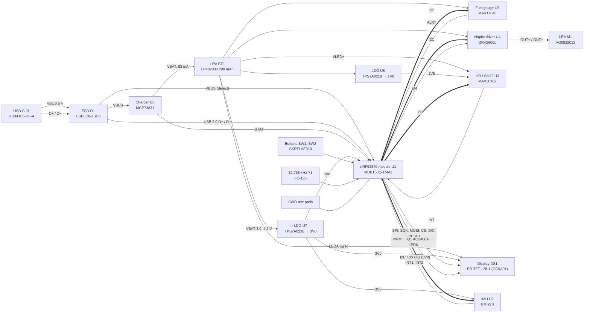

# Wearable watch: system

Block diagram, power rails, pin map and bus addresses. Source tags ([W2],
[W6] …) refer to the [component selection sources](component-selection.md#sources).
Pin numbers are the module's pad numbers from [W1] §2.5. The pin map is a
proposal for the board track; it respects the module's "low frequency I/O
only" pins [W1] §2.6.

## Block diagram

## Power rails

| Rail | Source | Range | Loads | Notes |
| --- | --- | --- | --- | --- |
| VBUS | USB-C | 5 V nominal (USB) | U6 VDD (3.75–6 V [W10]), U1 VBUS (4.35–5.5 V [W2]), D1 | Present only while charging |
| VBAT | Cell BT1 through its PCM | 3.0–4.2 V in use; cell rated 2.75–4.20 V [W12] | U7, U8, U5 VDD (2.5–4.5 V [W9]), U4 VDD (2–5.2 V [W7]), U3 VLED+ (3.1–5.0 V [W6]), display backlight anode | Firmware cut-off 3.40 V (see [power budget](power-budget.md#cut-off-voltage)) |
| 3V0 | U7 TPS7A0230 | 3.0 V | U1 VDD and VDDH tied (normal voltage mode [W2] §5.3.1), DS1 VDD (2.5–3.3 V [W3]), U2 VDD and VDDIO (1.71–3.6 V, 1.2–3.6 V [W5]), I2C and interrupt pull-ups | The display rule "VDD must power every device that drives its bus" [W3] §6.2 holds: U1 and DS1 share 3V0 |
| 1V8 | U8 TPS7A0218 | 1.8 V | U3 VDD only (1.7–2.0 V, abs max 2.2 V [W6]) | |

U1 runs in normal voltage mode: VDD and VDDH are both on 3V0, REG0 is off and
only REG1 (DC/DC, inductor inside the module) is used [W2] §5.3.1, [W1] §8.3.
The module's DCCH pin is left unconnected in this mode (**Assumption:** follows
from REG0 being unused; the board track confirms against [W1] §8.3's
reference schematic). Feeding VBAT straight into VDDH (high voltage mode) is
the alternative recorded in OQ-W2.

## Pin map (U1, Raytac MDBT50Q-1MV2)

| Function | Peripheral pin | nRF52840 GPIO | Module pad | Drive class [W1] | Pull / note |
| --- | --- | --- | --- | --- | --- |
| Display SCK | DS1 pin 9 SCL | P0.13 | 37 | full | SPIM3, up to 32 Mbps [W2]; clock set by firmware within GC9A01 limits |
| Display MOSI | DS1 pin 10 SDA | P0.14 | 36 | full | Write-only bus (no MISO) |
| Display CS | DS1 pin 8 CS | P0.15 | 39 | full | Active low |
| Display D/C | DS1 pin 7 D/C | P0.16 | 38 | full | |
| Display RESET | DS1 pin 11 RESET | P0.17 | 41 | full | Active low; must be applied at power-up [W3] §4.1 |
| Backlight PWM | Q1 gate → DS1 pin 2 LEDK | P0.20 | 44 | full | 100 kΩ gate pull-down keeps the backlight off in reset (Assumption: value) |
| I2C SDA | U2, U3, U4, U5 | P0.24 | 48 | full | 4.7 kΩ to 3V0 (Assumption: value, board track sizes it) |
| I2C SCL | U2, U3, U4, U5 | P0.25 | 49 | full | 4.7 kΩ to 3V0 |
| IMU INT1 | U2 INT1 | P0.22 | 46 | full | Wrist-wake, step events |
| IMU INT2 | U2 INT2 | P0.23 | 45 | full | FIFO / spare |
| HR INT | U3 pin 13 INT | P0.19 | 42 | full | Open drain [W6]; 10 kΩ to 3V0 |
| Haptic EN | U4 EN | P0.21 | 43 | full | EN has a 2 MΩ internal pull-down [W7], so the driver is in shutdown in reset |
| Haptic IN/TRIG | U4 IN/TRIG | — | — | — | Tied to GND (I2C-triggered playback) |
| Fuel gauge ALRT | U5 pin 5 ALRT | P0.06 | 22 | full | Open drain [W9]; 10 kΩ to 3V0 |
| Charger STAT | U6 STAT via R10/R11 | P0.08 | 24 | full | Tri-state [W10], driving high to VBUS: the 22 kΩ / 22 kΩ divider brings 5 V to 2.5 V for the 3V0 pin. Low = charging, high = done; high-Z (no cell, shutdown) reads low, so read it only while USBD reports VBUS |
| Button 1 (wake / select) | SW1 | P1.02 | 50 | low frequency | Internal pull-up; button to GND |
| Button 2 (back) | SW2 | P1.04 | 56 | low frequency | Internal pull-up; button to GND |
| 32.768 kHz crystal | Y1 | P0.00 / XL1, P0.01 / XL2 | 17, 18 | — | Load capacitors per Y1's 12.5 pF [W21] |
| USB D− / D+ | J1 via D1 | D−, D+ | 34, 35 | — | |
| USB VBUS | J1 via D1 | VBUS | 32 | — | USB regulator input and plug detection [W2] |
| SWDIO / SWDCLK | test pads | SWDIO, SWDCLK | 51, 53 | — | |
| Reset | test pad | P0.18 / nRESET | 40 | — | |
| VDD, VDDH | 3V0 | — | 28, 30 | — | Normal voltage mode |
| DCCH | — | — | 31 | — | Not connected (see rails) |
| GND | — | — | 1, 2, 15, 33, 55 | — | |

Spare full-drive GPIOs: P0.07 (23), P0.11 (27), P0.12 (29), P0.26 (19),
P0.27 (16), P1.08 (25), P1.09 (26). All interrupt lines use GPIOTE PORT
events, not GPIOTE IN channels: 2.36 µA instead of 17.37 µA in sleep [W2]
§5.2.1.1.

## I2C bus

One bus, 3V0 pull-ups, 400 kHz (the MAX17048 and MAX30102 limit; nRF TWIM
supports 400 kbps [W2]).

| Device | 7-bit address | Fixed or strapped | Source |
| --- | --- | --- | --- |
| MAX17048 (U5) | 0x36 | fixed | [W9] |
| MAX30102 (U3) | 0x57 | fixed | [W6] (0xAE / 0xAF 8-bit) |
| DRV2605L (U4) | 0x5A | fixed | [W7] |
| BMI270 (U2) | 0x68 | SDO to GND (0x69 with SDO to VDDIO) | [W5] |

No two addresses collide. Voltage compatibility with 3.0 V pull-ups:

| Device | Its supply | SDA/SCL limit | VIH | OK at 3.0 V? |
| --- | --- | --- | --- | --- |
| MAX17048 | VBAT | −0.3 to 6 V [W9] | — | yes |
| MAX30102 | 1V8 | −0.3 to 6.0 V [W6] | 0.7 × VDD = 1.26 V [W6] | yes |
| DRV2605L | VBAT | VDD + 0.3 V [W7] | 1.3 V [W7] | yes while VBAT ≥ 2.7 V, which holds whenever 3V0 is regulating |
| BMI270 | 3V0 | VDDIO-referenced | — | yes (VDDIO = 3V0) |

The MAX17048 pulls SDA/SCL down internally and sleeps if both stay low for
more than 1.75–2.5 s [W9]; the bus idles high, so this only matters if 3V0 is
off while VBAT is present (it never is in this design).

## Interfaces that leave the board

| Interface | Board side | Other side | Kind |
| --- | --- | --- | --- |
| Display FPC | 12 solder pads, 0.7 mm pitch | DS1 FPC tabs [W3] | Solder joint (hand or hot-bar) |
| Battery | 2 solder pads (+, −) | BT1 AWG30 leads [W12] | Harness `watch-battery-leads` |
| LRA | 2 solder pads (OUT+, OUT−) | M1 wire leads [W8] | Harness `watch-lra-leads` |
| USB-C | J1 at the board edge | Case opening | Mechanical: opening in `watch-case` |
| Buttons | SW1, SW2 at the board edge | Printed plungers in `watch-case` | Mechanical |
| HR window | U3 on the board's skin side | Window in `watch-back-cover` | Optical (OQ-W5) |
| Antenna | U1 at the board edge, no copper under the antenna [W1] §2.3 | Plastic case only, no metal near the antenna | RF keep-out |
