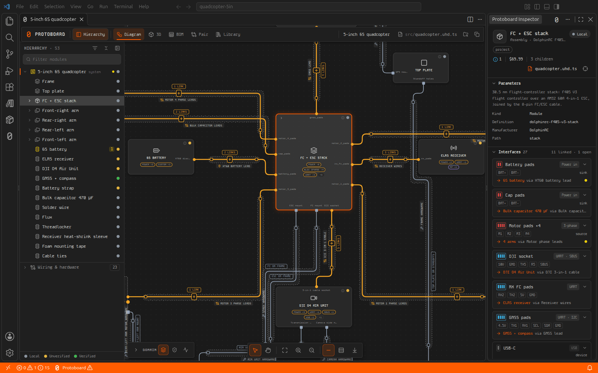
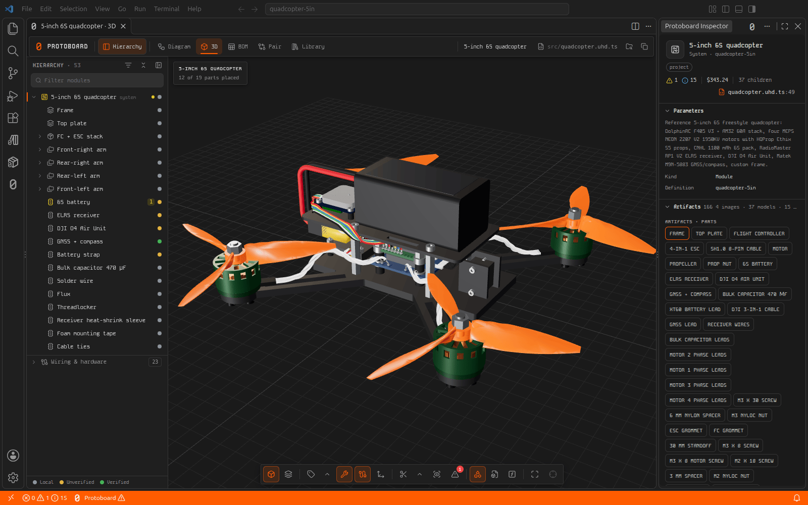
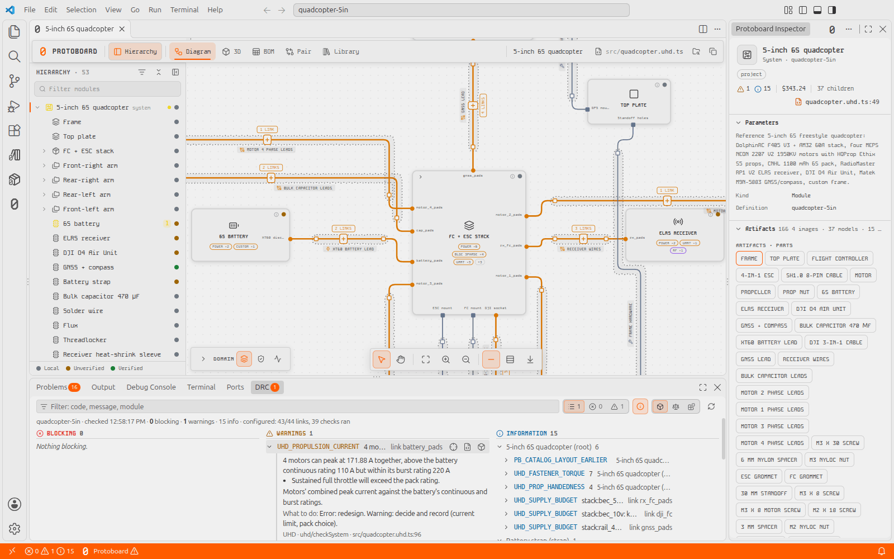

# Protoboard

Design hardware with your AI agent, and see it take shape in VS Code.

**[protoboard.ai](https://protoboard.ai)**

A Protoboard project describes a device as code: its modules, the
interfaces between them, and the cables that connect them. Your agent
writes it; Protoboard checks it as you go and shows it as a live diagram
and a 3D assembly.

## Features

- **Live system diagram.** Every module, interface and cable, updated each
  time the project changes. Open any module in its own tab.
- **3D assembly.** The assembled device, from each part's CAD model, with
  X-ray for what sits inside.
- **Checks as you work.** Design rule checks run on open and on save, with
  every finding in the DRC panel and at its line in Problems.
- **Inspector.** Everything about the selected module: parameters, files,
  checks, connections, and where to buy its parts.
- **Parts library.** Search parts with their CAD, datasheets and prices,
  and add them to your project.
- **Manufacturing package.** One command produces the BOM, ordering list,
  assembly guide, test plan and manufacturing files.
- **Your agent, connected.** Connects Claude Code, Codex, Cursor, Windsurf,
  GitHub Copilot or any MCP client to your project in one step.
- **Protoboard Dark and Light** colour themes.

## Get started

1. Install the extension. It brings the whole Protoboard toolchain with
   it, so there is nothing else to set up. **Get Started with Protoboard**
   opens the first time (later: **Protoboard: Get Started**, or Help in the
   Protoboard Cloud side bar).
2. Open the drone example from that page: a complete 5-inch quadcopter,
   copied to a folder you choose, with its diagram, 3D assembly and checks.
   It needs no account. Trust the folder when VS Code asks.
3. Connect your agent from the same page, then ask it what to change, or
   start a project of your own with **Protoboard: New Project…**.

Already have a project? Open its folder, and Protoboard offers to set it up.

## Requirements

- VS Code 1.106 or later, on Windows, macOS or Linux.
- For circuit boards: Node.js 22 or later.
- For generated 3D parts: Python 3.11 to 3.14.
- For PDFs: Google Chrome, Chromium, Microsoft Edge or Brave.
- Optional: KiCad 10, for board layout.

Local work needs no account. The parts library needs a Protoboard account.

## Privacy

The extension records crash and performance data of its viewer tabs on
your machine only, in each project's git-ignored `.protoboard/local/telemetry/`
(setting `protoboard.telemetry.local`; off whenever VS Code's own telemetry
is off). It sends nothing unless you approve a specific report. Your project
files never leave your machine; the Protoboard service sees only your sign-in
and the library requests you make. Details: [local telemetry](https://github.com/Delta-Robotics-Inc/protoboard-stack/blob/main/docs/reference/telemetry.md).

## Learn more

- [protoboard.ai](https://protoboard.ai)
- [Installation guide](https://github.com/Delta-Robotics-Inc/protoboard-stack/blob/main/docs/guides/installation.md),
  by operating system and agent
- [Source code](https://github.com/Delta-Robotics-Inc/protoboard-stack)
- [Report an issue](https://github.com/Delta-Robotics-Inc/protoboard-stack/issues)

Protoboard is open source under the Apache 2.0 licence. Protoboard is a
trademark of Delta Robotics, Inc.
